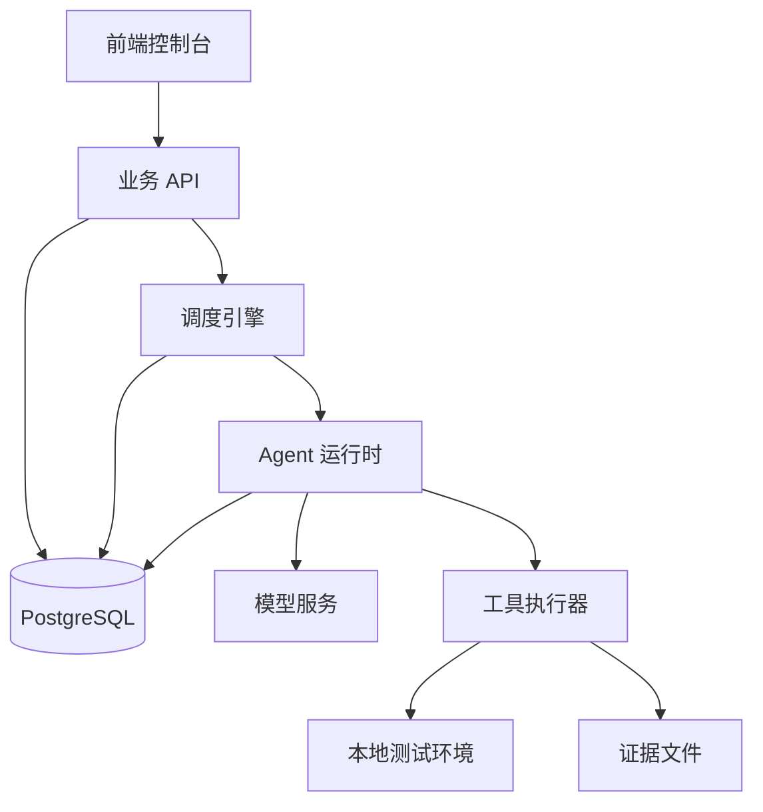
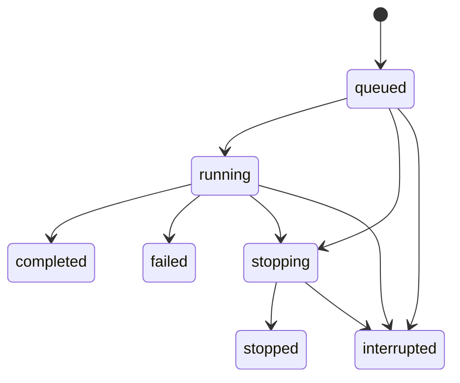

# 从零构建 Agent 工作台：架构与工程学习手册

> 2026-10-21 路线修订：用户已明确以学习 ARTEX 核心架构为优先目标。本文课程表是早期路线，实际阶段编号及核心差异见 [ARTEX 架构对齐审查与路线修订](ARTEX架构对齐审查与路线修订.md)。后续需补齐开放意图、双图/目标证明、可恢复执行、Planner 共享待办与过程级协作；不能把固定 HTTP 检查与人工审核当作整体架构终点。

> 整理日期：2026-10-19（Asia/Shanghai）  
> 项目：`oh-my-offensive-agent`  
> 代码复查基线：`ad03bea`；第一阶段加固实现：`448f562`。  
> 本文整理此前的架构讲解、课程路线、实现任务、验收方法与第一轮复查记录。后续课程可继续追加。

## 1. 我们在构建什么

目标是从零构建一个由模型驱动、能够执行工具、保存证据、持续推进任务，并允许人类查看和干预的工作台。以 ARTEX 核心机制为学习主线：逐项对照源码实现，再说明本工程的适配差异；不要求复制所有周边功能，但不能用最小流程永久替代自主探索机制。

完整工作流程：

```text
用户定义目标与范围
→ 创建一次执行
→ Planner 根据现有信息生成具体工作
→ Worker 领取工作并调用工具
→ 保存观察、资产、发现和证据
→ 通知 Planner 有新进展
→ 继续规划，直到达到退出条件
→ 整理结果与报告
```

不需要训练自己的模型。主要工程工作集中在任务编排、状态管理、工具执行、上下文组织和证据留存。

第一版在本地测试环境中验证机制，先实现一个稳定闭环，再扩展多 Worker、双图、流量录制、审批和复测。

## 2. 学习与实现的分工

| 角色 | 主要职责 |
| --- | --- |
| 项目负责人（你） | 理解架构，决定范围，检查行为，验收结果 |
| 实现 Agent | 编写实现、迁移和必要测试，提供运行方法与实际验证结果 |
| 教学与复查 Agent | 解释设计、拆解任务、检查边界，帮助建立工程判断 |

使用 Agent 写代码时，负责人仍需要掌握四件事：

1. 系统应该如何运行。
2. 哪些信息必须保存，谁可以修改它们。
3. 出错、停止和重启后怎么办。
4. 怎样通过可重复操作证明实现正确。

每阶段采用同一交付格式：设计说明、实现任务、验收标准、实际结果、剩余限制。截图和“测试通过”不足以替代行为验证。

## 3. 全部课程路线

| 阶段 | 核心知识 | 交付物 |
| --- | --- | --- |
| 1 | Task、Run、Event、状态机、幂等、快照 | 能启动、停止、记录历史的任务系统 |
| 2 | 模型适配、消息、工具调用循环、退出条件 | 能完成有限任务的单 Agent |
| 3 | 工具协议、输入校验、权限、取消、执行环境 | 可限制、可取消、可留痕的工具执行器 |
| 4 | Planner、Worker、工作派发与领取 | 能持续推进的规划与执行闭环 |
| 5 | 资产、观察、事实、证据与发现 | 有来源、可追溯的业务数据模型 |
| 6 | 多 Worker、原子领取、失联、重试、恢复 | 能处理并发与故障的调度系统 |
| 7 | 上下文压缩、过程检索、双图、共享记忆 | Worker 能复用前序成果的知识组织方式 |
| 8 | 审批、复测、报告、部署、运营 | 能交付和持续维护的工作台 |

课程按依赖关系推进。未来对象先明确含义，在对应阶段再实现。

## 4. 总体架构与职责边界

初始技术选择：Go 后端、Next.js 前端、PostgreSQL、Docker Compose，应用先采用单体结构。



| 模块 | 负责什么 | 必须守住的边界 |
| --- | --- | --- |
| 前端 | 展示状态，提交操作，查看过程 | 关闭页面不应停止后台任务 |
| 业务 API | 校验输入，保存配置，处理控制请求 | HTTP 请求不持续等待整项任务完成 |
| 调度引擎 | 决定何时执行、并发多少、何时停止 | 程序依据业务状态和预算控制执行 |
| Agent 运行时 | 调用模型，维护会话，处理工具调用 | 模型提出动作，程序负责校验与执行 |
| 工具执行器 | 执行实际操作，处理超时、取消和输出 | 每次调用可以识别、记录和限制 |
| 数据与证据层 | 保存业务状态、过程和原始结果 | 结论能追溯来源，历史不随当前配置改变 |

Planner 和 Worker 是 Agent 的角色；Engine 是普通程序。

Planner 决定值得做什么。Engine 根据状态、预算、并发和权限决定能否实际启动。Worker 完成领到的工作并记录新线索，后续方向交给 Planner 统一安排。

## 5. 两层循环：Agent 执行与项目调度

### 5.1 内层：一个 Agent 的工具循环

```text
程序提供目标、上下文和可用工具
→ 模型返回回答或工具调用请求
→ 程序校验并执行工具
→ 把结果交回模型
→ 模型继续判断，直到满足退出条件
```

模型不会因为输出一句“读取页面”，就自动完成读取。外围程序必须识别工具请求、执行操作、保存结果，再把结果返回。

### 5.2 外层：整个项目的调度循环

```text
Planner 产生工作
→ Worker 领取并执行
→ 结果保存
→ Engine 通知 Planner 有新进展
→ Planner 决定下一步
```

例如，一个 Worker 为观察本地页面连续执行几次工具调用，属于内层循环；Planner 根据这些观察再安排另一项工作，属于外层循环。

后台调度可以等待事件。循环存在，不代表模型一直在调用，也不代表一直消耗 Token。

## 6. 核心对象：区分定义、执行、工作和尝试

| 对象 | 含义 | 何时实现 |
| --- | --- | --- |
| Task | 用户想做什么；保存目标、范围与配置 | 第一阶段 |
| Run | Task 的一次完整执行；保存输入快照、状态和结束原因 | 第一阶段 |
| RunEvent | 某次 Run 中发生的一件事 | 第一阶段 |
| WorkItem / Intent | Planner 派发的一项具体工作 | 规划阶段 |
| Attempt | 某个 WorkItem 的某一次执行尝试 | 工作执行与重试阶段 |
| ToolCall | 一次具体工具调用及其输入、输出、状态 | Agent 与工具阶段 |
| Asset | 被观察或测试的对象，如服务、接口 | 资产阶段 |
| Evidence | 原始输出、响应、文件等支持材料 | 证据阶段 |
| Finding | 有证据支持的发现或结论 | 发现阶段 |

当前关系：

```text
Task 1 ── N Run 1 ── N RunEvent
```

未来可扩展为一个 Run 包含多项 WorkItem，一项 WorkItem 有多次 Attempt。Run 表示整项执行，Attempt 表示其中某项工作的重试，两者不是同一个层次。

### 6.1 为什么 Task 与 Run 分开

同一个任务今天运行一次，明天修改配置再运行一次，应保留两次执行历史。修改 Task 不应改变旧 Run 的目标或范围。

### 6.2 执行成功与业务结论分开

当前 `completed` 表示执行按约定完成，不自动代表发现漏洞、没有漏洞、覆盖全面或目标已经被证明。

未来分别保存执行状态与业务结论，避免把“程序跑完”和“验证成立”混在一起。

## 7. 第一课：状态机

状态机是允许发生的状态变化规则。

| 状态 | 含义 |
| --- | --- |
| queued | 已保存，等待执行 |
| running | 执行器已开始工作 |
| stopping | 已请求停止，正在收尾 |
| stopped | 执行已经停止 |
| completed | 执行按约定完成 |
| failed | 遇到无法继续的执行错误 |
| interrupted | 上次进程退出，执行未正常结束 |

课程最初使用 `succeeded` 表示正常完成，当前项目统一采用 `completed`。后续以项目实际名称为准。

主要流程：



`completed`、`failed`、`stopped`、`interrupted` 是终态，不接受后续进度，也不重新进入活动状态。

### 7.1 两项不同的检查

转换时需要同时验证：

1. 业务规则：这条转换是否允许，例如禁止 `running → queued`。
2. 并发状态：执行转换时，数据库中的当前状态是否仍符合预期。

状态名称属于允许的集合，不等于任意两个状态之间都可以转换。行锁或条件更新解决并发问题，显式转换规则解决业务问题。

### 7.2 请求停止与停止完成

用户点击停止时，程序先保存停止意图并进入 `stopping`。执行器处理取消、结束工作后进入 `stopped`。

不能因为已经发出取消信号，就认定执行器已经退出。未来接入工具进程后，还要验证进程是否实际结束。

### 7.3 第一阶段重启策略

启动时将遗留的 `queued`、`running`、`stopping` 标记为 `interrupted`，保存结束原因与对应事件。本阶段不自动重跑，避免尚未弄清操作副作用时重复执行。

正常关闭可以主动收尾为 `stopped`；异常退出留下的活动记录由下次启动处理。两条路径的终态不必相同。

## 8. 数据、事件、内存与快照

### 8.1 各自存什么

| 位置 | 内容 |
| --- | --- |
| PostgreSQL | 重启后仍需要知道的状态、输入和历史 |
| 内存 | 当前进程的取消句柄、运行控制、缓存 |
| SSE 等通知 | 告诉页面或其他组件有更新 |
| 文件存储 | 较大的工具输出、截图和证据文件 |

数据库保存停止意图；内存取消信号帮助程序快速响应。通知丢失后，仍应能查询数据库恢复显示。第一阶段使用轮询即可。

### 8.2 状态和对应事件一起提交

每次状态变化与对应 RunEvent 应在同一数据库事务中保存，避免“状态改了但没有历史”或“历史显示完成但状态仍在运行”。

事件需要稳定 ID、Run 内递增序号、类型、时间和内容。序号用于稳定排序，也为未来断线补读建立基础。

数据库事务不能保证外部工具只执行一次。外部操作已发生、结果尚未入库就崩溃，是后续工具与恢复课程需要单独处理的边界。

### 8.3 幂等与活动执行唯一约束

两者解决不同问题：

- 幂等：同一次启动请求被重试时，返回同一个 Run。
- 活动执行唯一约束：同一 Task 同时最多一个活动 Run，即 queued、running、stopping。

同一 Task 下，同一个幂等键与相同请求返回相同 Run；同一个键与不同请求应冲突。活动执行唯一性需要数据库保证，不能只依赖前端禁用按钮。

### 8.4 保存实际执行输入

当前 `execution_input` 保存 objective、scope、config 和 parameters。它与较早的 `config_snapshot` 同时存在；新执行逻辑应以明确的完整输入快照为依据。

以后逐步加入模型标识、提示词版本、工具配置与预算。快照应说明实际使用的配置，但不保存明文密钥。

老记录缺少原始输入时，标记缺失。不能拿当前 Task 内容补成看似真实的历史。

## 9. 第一阶段实现任务与验收

### 9.1 首版范围

实现 Task、Run、RunEvent；FakeWorker 默认执行十步，每步产生进度，支持正常完成、指定步骤失败和取消。

前端提供任务列表、创建任务、任务详情、历次 Run、Run 状态与事件时间线。先采用轮询更新。

交付 Docker Compose、版本化迁移、运行说明及关键行为测试。LLM、真实工具、多 Agent、图谱、MCP 和流量代理在后续阶段加入。

### 9.2 必须成立的规则

1. 同一 Task 最多一个活动 Run。
2. 重复提交同一次启动请求不创建重复 Run。
3. 终态不能被迟到进度或其他执行重新激活。
4. 状态与对应事件原子提交。
5. 修改 Task 不改变历史 Run 的输入。
6. 停止早于 Worker 注册或与执行竞争时，仍能收尾。
7. 关闭数据库前先等待 Worker 退出，并设置等待上限。
8. 集成测试使用明确配置的独立数据库。

### 9.3 手工验收

| 操作 | 预期结果 |
| --- | --- |
| 启动一次任务 | 创建一个 Run，持续出现进度，最后 completed |
| 快速重复启动或发送并发请求 | 不出现两个活动 Run；同幂等键返回同一 Run |
| 执行时关闭页面后重新打开 | 后台继续，已有历史仍在 |
| 执行中点击停止 | 进入 stopped，之后没有新执行进度 |
| 配置指定步骤失败 | 进入 failed，记录失败原因 |
| 异常终止后端并重启 | 遗留活动 Run 进入 interrupted，原事件保留 |
| 修改任务后查看旧 Run | 仍能看到旧目标、旧范围和旧配置 |

并发约束还需要后端测试证明。浏览器验收与集成测试互相补充。

### 9.4 可交给实现 Agent 的首版任务

> 使用 Go、Next.js、PostgreSQL，为 Agent 工作台实现第一阶段任务执行基础。采用单体应用。
>
> 实现 Task、Run、RunEvent。Task 保存目标、范围和配置；Run 保存本次执行输入快照、状态、时间和结束原因；事件具有稳定 ID 与 Run 内递增序号。
>
> 同一 Task 最多一个活动 Run，由后端与数据库保证。启动支持幂等；同键同请求返回同一 Run，同键不同请求报告冲突。
>
> FakeWorker 默认十步，按步输出进度，支持指定失败和取消。停止先进入 stopping，执行器退出后进入 stopped。状态和对应事件在同一事务内保存。终态不接受迟到进度和重新激活。
>
> 启动时把遗留活动执行标记为 interrupted，本阶段不自动重跑。提供任务页面、执行历史、事件时间线和轮询更新。
>
> 提供 Docker Compose、数据库迁移、运行方法、必要测试、已知限制与实际验证结果。测试使用独立数据库。当前阶段不扩展 LLM、多 Agent、真实工具、图谱、MCP 和代理。

## 10. 第一轮复查：从通过测试到检查边界

### 10.1 首版结果

2026-10-19 首次复查，在独立临时数据库中运行原有测试，8 个集成测试全部通过。

随后在临时源码副本中增加三个边界验证，均发现遗漏：

| 问题 | 复现或观察 | 工程含义 |
| --- | --- | --- |
| 提前停止卡住 | 保存 queued 后停止，Worker 尚未注册，随后启动失败，遗留 stopping | 持久化停止意图必须有效，不能只依赖内存信号 |
| 非法状态转换 | running → queued 被接受 | 并发检查不能替代业务转换规则 |
| 输入快照不全 | 仅保存 config，缺目标与范围 | 历史执行必须保留完整输入 |

另外发现原测试默认连接开发数据库，并执行 `TRUNCATE tasks CASCADE`；清理时还出现 Worker 访问已关闭连接池的日志。

这些结果说明：测试通过只代表被测试的规则通过。需要主动设计事件发生顺序，检查之前没有覆盖的边界。

### 10.2 提前停止的具体顺序

```text
Run 提交为 queued
→ Stop 请求保存 stopping
→ Worker 尚未注册，取消信号没有接收者
→ Worker 随后启动
→ queued → running 转换失败
→ Worker 报错退出
→ Run 留在 stopping，继续占用活动执行名额
```

修复方向是让 Worker 在启动、执行和退出路径处理数据库中的停止意图，管理器配合保留提前取消请求。数据库不可用等故障下的恢复保证仍要另行设计，不能把一次成功收尾扩展为所有故障下的保证。

### 10.3 第一阶段加固任务

> 修复停止早于注册、停止与进度写入竞争时的收尾，避免永久停留在 stopping。
>
> 建立显式状态转换规则，同时保留并发检查。禁止未定义转换。
>
> 保存完整执行输入快照，修改 Task 后历史保持不变。新增迁移，对历史缺失输入明确标注，不能使用当前内容冒充原始输入。
>
> 集成测试只接受明确配置的独立 TEST_DATABASE_URL，不回退到开发 DATABASE_URL。缺少配置时拒绝运行。
>
> Worker 管理器支持停止接收、取消和等待退出。测试与服务关闭先收尾 Worker，再关闭数据库，等待有上限。
>
> 添加对应回归测试，并发场景使用可控同步点，避免靠反复 sleep 碰运气。交付转换表、修复说明、测试命令与结果。

## 11. 当前实现与第二轮复查记录

### 11.1 已增加的实现

基于 `448f562` 及 `ad03bea`：

- 显式 `IsAllowedTransition` 状态转换规则。
- 完整 `execution_input`，含目标、范围、配置和本次参数。
- 迁移 004 为旧记录标记历史输入缺失。
- Worker 启动时读取持久化状态，并处理停止竞争和退出收尾。
- 管理器增加提前取消记录、关闭与等待机制。
- 测试只从 `TEST_DATABASE_URL` 读取连接信息。
- 新增可控步骤钩子，为竞争测试设置同步点。

### 11.2 实际运行结果

2026-10-19，在现有 PostgreSQL 实例中新建独立临时数据库，以 `TEST_DATABASE_URL` 指向该库运行：

```bash
cd backend
go test -count=1 -timeout 60s ./...
```

结果：测试包通过，当前共有 14 个测试函数；该次测试包耗时约 2.057 秒。测试后删除了本次创建的临时数据库。

覆盖内容包括正常完成、活动执行冲突、相同幂等键并发、参数冲突、指定失败、停止、启动恢复逻辑、终态保护、测试配置缺失、提前停止、停止与进度竞争、非法转换、输入快照、管理器关闭顺序。

本次修改前未提交变更为空。文档整理只新增本手册，没有修改业务代码。

### 11.3 验证范围与待跟进事项

测试通过可以支持继续学习下一阶段，不等于全面生产验收。以下边界保留明确记录：

1. 当前测试调用服务、管理器和 HTTP 测试路由；未在本次复查中进行浏览器验收或真实进程异常终止测试。
2. 重启测试主要通过插入遗留状态并调用恢复函数验证逻辑。后续补充 running、stopping 及真实进程退出路径。
3. 状态规则代码额外允许 `queued → stopped`；README 的主表只描述经 stopping 的停止路径。应明确是否保留直达路径，并统一规则、文档和测试。
4. 前端 Run 类型与快照显示尚未接入新的 `execution_input`。后端保存完整，不代表用户已能从页面查看完整历史输入。
5. 必填 TEST_DATABASE_URL 避免静默回退，但仍需使用独立测试库，不能把开发连接填进去；当前测试会清空该库中的任务数据。
6. 停机等待超时、数据库不可用、重复注册 Worker 等场景没有因本次测试通过而获得全面保证，后续按实际变更补测。

这些是明确的验证边界，不代表本轮已逐项复现了新的缺陷。

## 12. 后续课程的核心难点

### 12.1 Planner 的规划质量

Planner 要区分已完成、执行中、受阻和未开始的工作，并依据已验证前置条件安排下一步。共享待办有帮助，但模型维护待办不能替代程序检查领取条件和状态。

### 12.2 并发、重试与外部副作用

原子领取防止两个 Worker 同时拿到同一条工作。执行工具后、保存结果前崩溃，则需要结合操作性质判断能否重试。数据库去重不等于外部操作只执行一次。

### 12.3 观察、推测与结论分开

| 信息 | 含义 |
| --- | --- |
| 观察 | 工具实际返回了什么 |
| 推测 | 根据观察怀疑什么 |
| 已验证结论 | 哪些证据支持，成立条件是什么 |

一个 Worker 的推测不能自动成为其他 Worker 的事实。结论应关联具体工具调用、输入、输出和资产。

### 12.4 双图与共享记忆

资产图回答“对象是什么”；探索图回答“为何做这一步、做出了什么、支持什么结论”。两图通过资产关联连接。

最初用 PostgreSQL 的实体、关系与关联表即可表达，不必为了画图先引入图数据库。

过程检索可补充正式事实以外的细节。上下文变大后，需要摘要和按需检索，同时保留原始证据供回查。

### 12.5 触发规划与结束判断

防抖可以合并短时间事件，但不能判断每项变化是否值得规划。需要选择有效事件，避免模型空转。

没有待办不必然代表目标完成。未来分别记录目标已验证、方向耗尽、受阻、预算耗尽与人工停止等原因。

### 12.6 范围、权限与预算

提示词可以提供约束，执行层仍要校验工具、输入、范围、时间、轮数和成本预算。停止请求需要传递到模型请求、工具执行和结果写入等环节。

## 13. 第二课：Agent 运行时

下一阶段把 FakeWorker 的固定步骤替换为有限的模型与工具循环，继续沿用 Task、Run、输入快照与事件。

重点理解：

1. 模型适配器如何屏蔽不同服务的接口差异。
2. 一轮模型返回中，文本与工具请求如何表达。
3. 工具名称、参数、调用 ID 与结果如何对应。
4. 程序如何处理未知工具、错误参数和工具失败。
5. 如何限制轮数、调用时间及总执行预算。
6. 正常回答、模型错误、预算耗尽、停止与中断如何映射到执行结果。

完整课程、实现任务和验收标准已整理到同目录的《第二课-Agent运行时与工具调用循环.md》。该课当前为设计与待实现任务，不能视为已经实现或验收通过。

## 14. 与实现 Agent 协作的固定交付要求

每轮只交付一段可以验收的能力，并要求实现 Agent 回传：

- 解决的问题和最终行为。
- 模块职责、数据变化和状态转换。
- 数据库迁移及旧数据处理方式。
- 测试命令、实际结果与未验证部分。
- 启动方法、配置和已知限制。

检查测试是否使用真实数据库、是否碰到开发数据、是否等待后台执行退出。涉及并发时优先使用同步点控制顺序；发生过的缺陷应转成回归测试。

## 15. 当前源码导航

以下路径均相对项目根目录：

| 文件或目录 | 用途 |
| --- | --- |
| `backend/cmd/server/main.go` | 启动、路由装配、信号处理与关闭 |
| `backend/internal/model/model.go` | 数据对象、状态名称、转换规则 |
| `backend/internal/handler/` | HTTP 输入输出、调用服务和管理器 |
| `backend/internal/service/task.go` | 任务定义的业务操作 |
| `backend/internal/service/run.go` | 创建执行、快照、幂等、状态与事件事务 |
| `backend/internal/worker/manager.go` | Worker 注册、取消、关闭与等待 |
| `backend/internal/worker/fake.go` | 模拟执行、步骤失败与停止收尾 |
| `backend/internal/db/db.go` | 数据库连接、迁移与启动恢复 |
| `backend/migrations/` | 版本化数据库变更 |
| `backend/test/integration_test.go` | 生命周期与边界回归测试 |
| `frontend/src/lib/api.ts` | 前端 API 客户端 |
| `frontend/src/lib/types.ts` | 前端业务类型 |
| `frontend/src/app/tasks/` | 任务、执行历史与执行详情 |
| `docker-compose.yml` | 本地运行编排 |
| `README.md` | 项目运行、接口与验证说明 |

## 16. 后续记录模板

后续每一课按以下格式追加，避免设计意图与实际状态混淆：

```text
课题与日期：
解决的问题：
新增对象与模块：
必须成立的规则：
给实现 Agent 的任务：
手工验收方法：
实际测试命令和结果：
代码基线：
未验证部分与下一步：
```

## 17. 第二课进度记录（2026-10-19）

- 课程已编写：`docs/第二课-Agent运行时与工具调用循环.md`。
- 设计目标：在第一阶段生命周期之上实现有限的单 Agent 工具循环。
- 实现分两步：脚本化 MockProvider 验收运行时，再接一个真实模型协议。
- 练习：通过两个内置工具读取固定 HTTP 响应样本，生成有来源的观察报告。
- 当前状态：课程设计完成，业务实现与第二阶段测试尚未执行。
