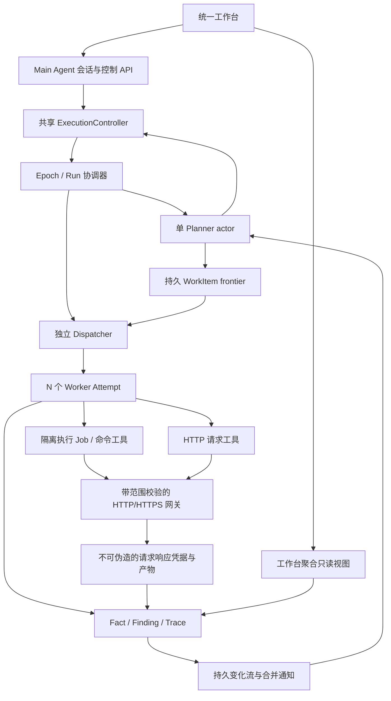

# 多 Agent 核心可用性与工作台：开发总计划

日期：2026-10-22。审查基线：`1aacadc`。本文是下一轮待开发契约，不是完成报告。目标是学习并实现 ARTEX 的基本多 Agent 工作方式，优先解决实际多 Worker 可用性、行动能力和指挥链，再交付统一工作台。

## 1. 这轮交付什么

最终用户能够输入授权任务，由 Main Agent 理解和操作任务，Planner 根据事实持续拆解、监督和调整方向，N 个 Worker 使用真实工具并行推进，保留可检索的过程与证据；局部错误不拖垮其他方向，用户能在一个工作台里指挥、观察、恢复和查看最终交付。

“能用”的样例不是并发请求同一页面：在本地受控的、带认证的 HTTP/HTTPS 应用中，多 Worker 分工发现入口、分析材料、验证一个可重复的测试问题；有一个方向失败/耗尽时其余方向继续，Planner 可以纠偏/终止/续派；最终提交有来源的结论和未完成部分。用户再通过 Main Agent 增加线索或续跑，原方向和过程不丢失。

保留现有 Task/Run/WorkItem/Attempt/Session、范围快照、预算账本、双图、证据、人工审核及独立复测。只有一套执行内核；不重写成另一套 agent 框架，不新增一个与现有预算/停止无关的“高级模式”。

### 必须完成

- 一套可配置 N Worker 池，默认 3、服务端范围 1–8；1/2/4 都经过验收，UI 的“双 Worker”成为 N=2 的兼容配置。
- 并发配置贯穿 UI、请求、快照、实际 Engine；发现模式不能偷偷强制串行。
- 单 Planner 规划循环、独立 Dispatcher 与有界 Worker 池；在途事实可触发新方向，不能等待整批完成。
- 两种模型协议的会话隔离、错误分类、有界恢复、共享模型请求限流；真实坏响应不能伪装成功。
- Planner 主动 steer/kill/continue/retry；Main Agent 对话调用同一控制服务。
- HTTP/HTTPS、请求方法、参数、认证引用和证据；受控命令/脚本执行、停止及产物留存。
- 三栏工作台：任务/会话导航、主对话/活动方向、证据/过程检查器，统一显示真实状态。
- 本地协议替身 + 真实应用/执行容器 + 浏览器端到端验收；另有显式授权的真实模型 smoke 入口。

### 暂缓且不计为这轮欠交付

完整 MCP 市场、skills 管理 UI、复杂模型路由市场、自动语义压缩重做、企业/租户系统、分布式队列和集群、向量记忆、复杂图可视化、企业资产 DSL、任意 TCP/raw-socket 扫描、整套 Kali 工具链、浏览器自动化攻防、丰富报表模板。现有相关能力保留。具体能力按需注册，不能用“将来接 MCP”代替这轮真实工具交付。

## 2. 已核实的基线与并发问题

详见《并发与失败排查基线》。本轮只读检查，未发起真实模型请求、未操作靶场、未修改运行记录。

1. `handler/run.go:startRunExecutor` 在发现模式下硬编码 `budget.MaxParallelWorkers = 1`。这与页面可选双 Worker 不一致，必须优先消除；但直接删掉这行并不证明发现限流/去重/认领已经并发安全。
2. 当前库 33 个 Run：24 个快照显式为 1，9 个旧记录字段缺失，没有保存 N=2 的记录。需要追踪配置链路，不应断言用户看到的失败已经由并发竞争证实。
3. 最近 failed Run `28f298eb-43ad-4a7b-aa0b-c8cd3d6f8300` 的 Planner 返回 `protocol_error`；模型错误摘要为 `incomplete function arguments or status`。这是协议响应问题，不能靠禁止并发掩盖。
4. 最新 Run `fa4a8546-5667-48b5-b1bc-da194ef2c97f` 是 stopped/tool_calls_exhausted；工具调用里有多次 trace/profile/artifact 阅读。它与协议错误、Worker 局部耗尽需要分别诊断。
5. 当前默认总模型/工具次数各 30、时长 120 秒，不适合作为所有多 Worker 长任务的无差别默认值。预算模板需要显式配置、快照和展示，但不能仅增大预算掩盖重复规划。
6. 上轮通过过本地竞态和浏览器回归；旧测试仍保留。新的发布门槛包含发现模式、N=4、协议故障和命令进程树，不能拿旧“双 Worker Mock 通过”替代。

## 3. ARTEX 参考机制与本工程选择

| 机制 | 参考源码（相邻 ARTEX，只读） | 本轮要求 |
| --- | --- | --- |
| 常驻 Planner、事件/心跳监督 | `server/engine.go:plannerLoop`、worker loop | 单 Planner 规划资格；Dispatcher 可独立领取，不被 Planner 模型调用阻塞 |
| 在途方向监督 | `agent/tools.go:PlannerTools`、`killWorkTool`、`steerWorkTool` | 模型工具与页面、Main Agent 共用控制服务，不能模型直接写取消状态 |
| 稳定 Worker 记忆与真实工具 | `agent/worker.go:execute` | 保留 WorkItem 对话，新增真实 HTTP/脚本能力，局部收尾不再探测 |
| 主 Agent 对话与任务控制 | `agent/mainagent.go:Chat`、MainAgentTools | 主会话独立持久化，可读态势/证据并执行用户明确要求的控制 |
| 工具绑定和模型配置 | `agent/toolcatalog.go`、`AugmentTools` 实际定义 | 按角色配置工具和模型，旧单一模型配置作为默认回退 |
| 命令输出、代理与 CA 信任 | `agent/worker.go` 的 BashEnv/WorkingDir/ToolOutputDir | 容器执行、HTTP/HTTPS 捕获及证据引用，不给 API 或模型宿主机 Shell |
| 原始 trace / 目标证明 | `agent/capture.go`、`agent/tools.go` | 复用现有知识、产物与证明服务，不增加伪证据捷径 |

有意差异：保留本工程 PostgreSQL 状态权威、execution epoch、总硬额度与授权账本；暂停先保持现有在线屏障语义。ARTEX 的人类消息路径可绕过池槽位，本工程所有新增 Worker 执行都受 N 上限约束，避免恢复或聊天悄悄超配。来源 verified 仍不等于自然语言命题自动成立。

## 4. 目标架构及边界



- **Main Agent**：用户交互与操作，不取代 Planner，不同时启动第二套规划循环。
- **Planner**：根据最新事实决定工作、等待、监督和结束；一轮新 Session，共享持久 Todo。
- **Dispatcher**：只做资格、槽位、认领与启动，不调用模型决定方向。
- **Worker**：只推进领到的方向；通过已授权工具行动、保存结果。Worker 不自行加总预算或创建无限子 Worker。
- **Run 协调器**：统一终态、停止、旧代次撤销、故障影响范围；先撤销准入/停妥 Dispatcher，再等待 Worker 清理，避免 WaitGroup Add/Wait 竞态。
- **工具服务**：网络/进程停止和证据各有真实实现；模型提示词不是权限实现。

## 5. 固定契约与工程不变量

以《接口与状态契约》为准。Agent 0 在开工时把草案落实为可编译接口/fixture 合同，提交一个共同契约 commit，各分支基于该 commit。其它 Agent 不自行更改 DTO、迁移编号或共享接口。

### 并发和状态

- 同 Run/Epoch 最多一个有效 Planner；活跃 Worker Attempt 不超过 N；同 WorkItem 最多一个活动 Attempt。
- configured/requested/effective/active 分开；因服务端上限拒绝时返回字段错误，不静默把 4 改成 1。
- discovery 的 origin pacing、页面限额、去重、资产登记与领取原子安全；锁内不发网络或模型请求。
- 工作局部 protocol/provider/tool/timeout/额度错误保留原 Attempt 原因，进入明确的失败/耗尽状态；其它方向继续。持久化不可信、Epoch 失效、全局停止/硬额度等走 Run 协调器。
- Planner 故障使用有界重试及退避；达到上限转为 needs_input 或明确失败并保留方向。不能不断循环、吞掉错误或把不完整调用补成成功。
- Worker 池并发和模型请求并发是两个配置：N=4 可以在上游只允许 2 个请求时排队；等待额度/限流需对取消敏感。
- 次数按真实模型请求记账，包括恢复尝试；不盲目重放结果未知的外部操作。
- Pause 禁止新模型/工具准入；已发出的请求如取消则记录其实际/未知结果。Stop/Kill 清理 HTTP、排队请求和命令进程树；旧 Epoch 不能提交新副作用或覆盖新状态。
- 队列空不等于目标完成；active worker > 0 时 Planner 无新方向是合法 wait。

### 预算与错误

保留旧快照/旧任务含义。新任务提供可编辑的“快速验证”和“探索任务”模板，例如探索模板可从总模型 80、总工具 200、600 秒、Worker 8 模型/25 工具/120 秒起步；这些是显式初始授权，最终值写快照，不是自动续租承诺。Planner 预留和主对话预算单列，不让 Worker 把监督所需额度全部吞掉。Agent 1/2 用实测修订模板，不能只放大数字修问题。

统一错误字段至少含 code、scope、retryable、message、source ID。区分 worker_exhausted、run_budget_exhausted、upstream_rate_limited、invalid_model_output、credential_unavailable、scope_denied、execution_unavailable、persistence_error；UI 展示下一步可执行动作，不能所有情况只显示 failed。

### 证据与权限

网络请求和容器命令都需要 Run/Epoch/WorkItem/Attempt/Session 绑定。新 HTTP 工具和捕获网关只能生成程序验证的来源凭据；“命令退出码 0”或 curl stdout 不能直接证明目标漏洞。保留现有 get_endpoint 的证据兼容，report_finding 和 retest 不接受任意新增工具名绕过来源校验。

## 6. 开发里程碑

### M0：合同与隔离基线（Agent 0，Agent 7 起草反例）

- 记录实际版本、运行镜像时间、请求并发和有效并发；只读获取失败原因，保留脱敏重现资料。
- 定义 runtime/model/tool/control/workbench 合同、错误分类、文件归属、迁移编号和 fixture 场景。
- 在独立数据库跑现有回归；不清理开发库，不修改旧 Run 伪造成功。
- 建集成分支和各工作树；完成契约 commit 后再放行并行实施。

**退出条件**：每个 Agent 拿到同一 commit、稳定合同和测试入口；无“前端先猜字段”的悬空依赖。

### M1：真实 N Worker 运行时及模型协议（Agent 1 + 2，最高优先级）

Agent 1：消除发现模式强制串行，校验全链配置；将运行时整理为独立规划/派工循环、受控池和统一收尾。支持 N=1/2/4，不新增 DualExecutor。事件合并、Cursor、wait、心跳监督及系统依赖阻塞恢复明确。只有新材料或有界策略允许继续同方向，不能换 key 无限续派。

Agent 2：模型协议诊断和恢复。处理 Responses 的不完整 function arguments/status、截断、refusal、429、5xx、超时；仅程序可验证的兼容形式才归一化。坏 JSON 不执行工具、不乱改 call_id；有界再次请求消耗真实模型预算。每个 Session 独立原生历史，Provider 无共享对话。增加按角色 model/runtime 解析及共享上游请求限流，默认回退旧配置。

**退出条件**：发现模式 N=4 真正重叠；一个 Worker 协议失败、一个局部耗尽、一个慢调用时第四个仍可推进；不超 N、不超总额度、不出现活动子记录泄漏。不能用单 Worker 兜底、强行标 completed 或删除断言过关。

### M2：真正可行动的 Worker（Agent 3 + 4）

**HTTP/HTTPS**：通用 http_request 工具，方法、路径/查询、头、body、超时、认证别名；授权方法、origin/path、重定向每跳、TLS、并发限流、响应体积和证据均服务端处理。支持登录 cookie 或预配 token 的受控会话；跨方向只通过显式共享会话引用，不能共享可变 cookie jar 导致串号。支持表单和 JSON；密钥留服务器，不出现在模型/URL/日志里。

**命令/脚本**：命令在专属执行容器与工作目录运行；可运行 Python、curl 及小型分析脚本，保留脚本、stdout、stderr、退出码和工具调用来源。每个 Attempt 的执行空间隔离，停止后杀进程树和后台子进程，输出超限保留完整有界产物并明确截断。运行 image、CPU/memory/pids/时长由服务器配置。

API 容器与执行容器均不挂宿主机 Docker socket；专用 broker 只接受固定 Job 协议创建/停止允许镜像的容器，不执行宿主机命令。执行容器非 root、无 privileged/host network/宿主目录、drop capabilities、只读根和受控写目录。模型命令不得覆盖其它 WorkItem 的工作空间或读取 .env。

执行容器的 HTTP/HTTPS 访问经过实际强制的网关/出口规则；只设置 HTTP_PROXY 不算范围隔离。网关验证 Job 作用域，处理 CONNECT/CA 信任与捕获，拦截未授权目标及代理旁路。允许用户明确授权的内网靶场，不能用一刀切禁止私网替代范围校验。原生 TCP/原始套接字等本轮暂不开放。

Agent 3 负责捕获网关/HTTP 证据合同；Agent 4 负责容器出口与网关接入。二者先用合同测试联调。可以先提交离线脚本阶段，但最终验收必须演示隔离环境中的脚本/HTTP 工具链，不能把离线 echo 演示算交付。

**退出条件**：Worker 能认证读取 HTTPS fixture、生成并执行分析脚本；受控请求留可查证据；未授权重定向/直接出口/宿主文件/跨工作目录失败；Kill/Stop/Epoch 撤销后无子进程泄漏。命令输出不能伪造 empirical 来源。

### M3：指挥链与 Main Agent（Agent 5，依赖 M1 控制合同）

- 将 Planner 的 steer_work、kill_work、continue/retry、态势/trace/产物读取集中装配，初始轮和后续轮工具资格一致；纠偏在下一工具动作前使 Worker 重新评估，不能先执行原来已规划的动作再看到纠偏。
- 建立 ExecutionController 共享入口。REST、Planner 和 Main Agent 共用事务、版本/幂等、Manager 取消及唤醒，不调用 Handler 内部 HTTP 接口、不复制状态修改 SQL。
- Main Agent 独立持久会话，支持解释现状、引用真实来源、提交方向/线索、纠偏和用户明确指示的暂停/停止/恢复。原 WorkItem 历史与 Main 对话不混写；同会话用户回合串行且幂等。
- 角色配置最低支持 main/planner/worker/verifier；默认同模型即可，不强制每角色不同服务。密钥用别名，快照记录非敏感配置和版本。
- Main Agent 不能自己加总预算、扩大授权、将用户一句模糊描述当作新范围。已有明确用户指令可直接执行授权内操作；总额/范围变更复用现有结构化授权动作，不建立泛化的每命令审批系统。
- completed 扫描默认只读；用户明确继续时调用同一 Epoch 恢复通道，保留旧终态/总结，不能在聊天中暗造第二个 Engine。

**退出条件**：Planner 能自己查看一个跑偏方向的 trace 并 steer/kill；用户可在 Main 会话查询并操作另一方向；所有动作可追到真实控制命令、目标 Attempt 和结果。无假聊天、无独立假执行器。

### M4：工作台重构（Agent 6，可并行做结构，最终依赖 M3）

保留现有 Next/React 栈与旧数据，不把迁移框架当主任务。使用 `/workbench` 统一入口，Task/Run/WorkItem 可深链接；旧路由重定向或链接进新工作台，旧记录仍能查看。

```text
┌任务/Run 导航────┬主对话 / 执行态势──────────────────┬检查器──────────┐
│ 新任务          │ 当前目标、运行状态、Epoch、预算    │选中方向/资产   │
│ 当前与历史 Run  │ Main Agent 对话（含真实工具动作）  │Attempt/消息    │
│ Planner         │ Planner 最新计划/等待理由          │工具请求与响应  │
│ 活动与等待方向  │ N Worker 方向板：运行/排队/耗尽     │完整产物/事实   │
│ 历史方向        │ 统一活动流、失败和可恢复动作        │发现/证明/复测  │
└────────────────┴──────────────────────────────────┴────────────────┘
```

- 顶部显示 configured N / active / queued、共享模型请求并发、总与局部预算；主对话与证据可以同时看，不再是一张很长的详情页。
- 工作方向是稳定实体，Attempt 是执行历史；不能把 4 个模型调用画成 4 个 Worker。卡片可见方向目标、依据、当前步骤、进展和错误范围。
- 用户可从任意选中方向发 steer/kill/continue/retry；提交有 pending/结果/409 冲突反馈，显示幂等命令与来源。失败不能只弹 alert 或静默吞掉。
- 主对话里的 action 消息引用真正 Session/Command/WorkItem；禁止假装正在打字的演示聊天冒充后端执行。
- 检查器可以按需查看原始证据/产物；不要一次拉全体消息和工具大正文。单个轮询源或查询层负责同步，避免每个组件各发全量请求。
- 原规则检查/审核收进证据与发现视图，不再主导整个页面；保留历史含义。
- 断线、刷新、选中方向变更、终态后复测都有稳定表现。轮询足够可用时可暂缓 SSE；若做 SSE 必须有游标重连与快照兜底。
- 提供窄屏布局、键盘焦点、加载/空/错误态。采用克制的工作台视觉，不用炫图替代可读流程。

**退出条件**：N=4 全流程通过浏览器；用户能只靠工作台完成创建、观察真实并发、聊天干预、读证据、停止续跑与交付。刷新后方向、过程和原引用仍可恢复。

### M5：集成验收与可运行交付（Agent 0 + 7）

M1 未通过前不能把项目标为多 Worker 可用；M2/M3 未通过前不能把新工作台标为 ARTEX 基本功能完成。集成时小批次合并，复跑受影响专项，再跑一次最终全套；不要每个 Agent 都盲跑互相清表的全库测试。

## 7. 端到端验收矩阵（全部为必需）

| 编号 | 场景 | 必须断言 |
| --- | --- | --- |
| A01 | UI→创建→快照→Engine，N=1/2/4，含 discovery | 请求和 effective 一致；至少 N=4 具有真实重叠，不是累计数量 |
| A02 | 4 个不同方向的认领 | 无重复领取、无同方向双 Attempt、峰值不超 N；新增方向不等整批结束 |
| A03 | 在途新事实派生方向 | A 未退出，Planner 可派 B；无新方向可以 wait，无模型风暴 |
| A04 | 一个 Worker 协议坏响应/另一个局部耗尽 | 其它 Worker 有进展；局部原因真实保留；有界恢复，不整 Run 误失败 |
| A05 | Responses 不完整参数、截断、429、5xx | 不执行坏工具；重试有限、真实记账、不会共享原生历史或无限重放 |
| A06 | 2 个模型请求额度服务于 N=4 | 有界排队；暂停/停止解除等待；不假装请求已经执行 |
| A07 | Planner 监督 | 根据 trace steer 一个方向并 kill 另一个；只影响目标；同意图恢复原历史 |
| A08 | Main Agent 对话 | 真正读取/控制；重复请求幂等；终态查询不另启 Engine；不能加总额度或扩范围 |
| A09 | 认证 HTTP/HTTPS fixture | Cookie/Token 别名、JSON/表单、TLS、重定向逐跳检查，身份不串号 |
| A10 | 并发发现与网络限额 | origin 限流、页面/请求上限、去重在并发下成立，锁内不发网络 |
| A11 | 容器命令执行 | 真实脚本/curl、产物/退出码可查、无宿主或跨方向访问、代理绕过被拒绝 |
| A12 | Kill/Stop/重启/旧 Epoch 迟到 | 进程树/HTTP/请求排队清理；旧执行不能污染新代次；运行用量不归零 |
| A13 | 目标证明与发现 | 请求/响应/产物来源可信；读知识或命令 stdout 不冒充实测；撤回/fixed 仍使证明失效 |
| A14 | 真正的业务协作 fixture | 入口发现→认证分析→脚本处理→可重复测试问题→证据交付；至少两个 Worker 有材料性协作 |
| A15 | 浏览器工作台 | 创建、真实 N=4、聊天纠偏、方向切换、证据、停止恢复、刷新、错误及终态视图全走 UI |
| A16 | 升级、历史及最终发布 | 旧数据/审核/快照可读，新迁移增量安全；全库 race、vet、前端 build、Compose 启动和 smoke 通过 |

关键并发反例用通道/屏障确定时序，不能仅 sleep 后数 completed。Agent 7 提供重叠证据：各 Attempt 起止、峰值 active、关键事件顺序。A01–A08 至少反复运行 20 轮并记录结果；最终稳定套件跑一次完整 race。性能不靠删约束换取。

本地替身验证工程机制；真实模型长任务质量另外记录。用户明确给出测试服务/目标和额度后，运行有界真实模型 smoke；未授权不付费调用。没有真实 smoke 时不能写“真实模型已稳定”。

## 8. Agent 分工、所有权与并行顺序

| Agent | 角色 | 主要拥有的文件 | 依赖与集成点 |
| --- | --- | --- | --- |
| 0 | 合同与集成负责人 | 本目录合同、公共 DTO/路由挂载、根 Compose、共享模型变更、版本与交付 | 先交共同契约 commit，最后统一合并和验收 |
| 1 | N Worker 运行时 | orchestration engine/budget/scheduler、worker manager、service admission/agent/run 的运行时部分；026 迁移 | M1 先落地；与 2 联调；run handler 的串行限制修改在 M1 归 1 |
| 2 | Provider 与角色运行配置 | provider 包、SessionRunner 的协议/调用策略片段、新 role resolver；027 迁移（确需时） | 与 1 按接口协作，不自行改 Engine；Service 冻结快照接线交 0 |
| 3 | HTTP/HTTPS、认证与捕获证据 | 新 http_request/transport/gateway/authref、verification 的新来源适配；028 迁移 | 旧 get_endpoint 向共同 transport 兼容；网关合同供 4 接入 |
| 4 | 隔离执行环境 | execution broker/runner/jobs、命令工具、执行镜像/部署片段；029 迁移 | 无 Engine 改写；通过已冻结的工具工厂挂载，依赖 3 网关 |
| 5 | 指挥工具、Main Agent 与聚合 API | 新 controlplane/mainagent/workbench 服务与 handler、Planner tools 组；030 迁移 | M1 后取得 run handler 控制接线所有权；Engine 注册改动给 0 集成 |
| 6 | 前端工作台 | frontend/src、样式/组件、api/types、Next/package 配置 | 合同先行，可先静态结构/fixture adapter；最终必须连真实 API |
| 7 | 验收负责人 | 新 ma_* 集成测试、受控应用/模型 fixture、独立 e2e、验收证据 | 从 M0 写失败用例，最终集成分支运行；不得通过放宽断言改业务契约 |

**公共文件管理**：`backend/cmd/server/main.go`、公共 model/schema、统一工具注册、root Compose、共享协议与依赖由 0 集成。Agent 2 的 SessionRunner 片段与 Agent 1 的暂停/gate 改动需要 0 做逐段合并，不允许双方互相覆盖；其余人不要碰该文件。每个 Agent 可维护自己命名的测试文件。026–030 只是保留编号，需新增时才创建，空号允许；新增额外迁移由 0 分配，不能重写已应用的 001–025。

同文件的跨域修改以“集成补丁清单”提交给 0，包含插入点、依赖 commit 与所需接口；不要擅自改别人分支。0 不得最后一次性复制整目录覆盖。

### 建议派发波次

1. 先把 Agent 0 提示词交给协调 agent。它完成合同、基线和工作树后，提供共同 BASE_COMMIT。
2. 第一波：1 + 2 解决运行时；3 + 4 先按网关/Job 合同做各自模块；6 做前端结构；7 写 fixture 和验收。机器/名额不足先运行 1、2、7，其次 3/4，最后界面。
3. 第二波：M1 合入后启动 5，1 不再编辑已交接的 run handler。6 由 fixture adapter 转真实接口；3/4 联调捕获链。
4. 第三波：0 统一接线与合并，7 在集成分支验收，失败退回明确 owner，不让各 agent 同时修同一文件。

无需同时开八个 agent。0 是贯穿全程的集成角色，7 可分阶段运行；建议同时最多 3–4 个编码工作树，避免资源和测试数据库竞争。

## 9. 弱模型也必须遵守的交付方式

- 每个 Agent 开工先用自己的话列出目标、输入接口、允许修改文件和验收；有合同歧义报告给 0，不能自己补一个不兼容字段。
- 用小步骤提交：失败用例 → 最小语义修复 → 相关反例 → 文档/交付说明。不能只写计划或宣布完成。
- 交付 `实现`、`实跑测试`、`尚未验证`、`有意差异` 四列；附 commit、命令和可复查证据。不用“预计完成 95%”。
- 保留历史事实，不通过改旧 Run/删除失败记录/降低并发/假 UI/硬编码目标页面过关。
- 只用各自隔离测试库和 fixture；不打印 .env、不扫外部目标、不默认调用付费模型、不重启开发服务。
- 工作树分支统一 `codex/ma-*`，不直接推 main。各 Agent 可做本地 commit，由 0 集成；未经本轮用户额外要求不 push、部署或合并主分支。
- 本地 AGENTS.md 复制到新工作树供读取并保持排除。用户另有未提交技术分享稿，不纳入本轮更改。

## 10. 最终交付物

- 一条集成分支及清晰的小提交，不提交凭据或 AGENTS.md。
- `验收结果.md`：A01–A16 逐条链接实际证据、命令、失败与修复、已知差异。
- `运行手册.md`：一套 Compose 构建/启动、迁移、模型/角色/认证别名配置、隔离执行环境、日志、升级与停止命令。
- `架构说明.md`：主 Agent→Planner→Dispatcher→Worker→真实工具→证据→监督/恢复的真实调用链。
- 工作台截图/录屏与浏览器测试；只能引用当次实际生成的证据。
- 清晰说明哪些 ARTEX 机制已对齐、哪些是工程适配、哪些功能明确暂缓。
