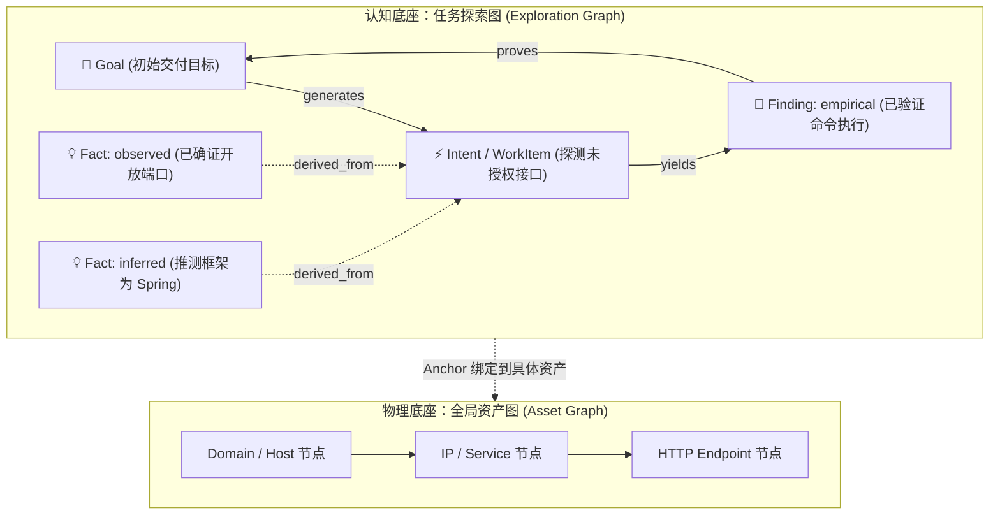
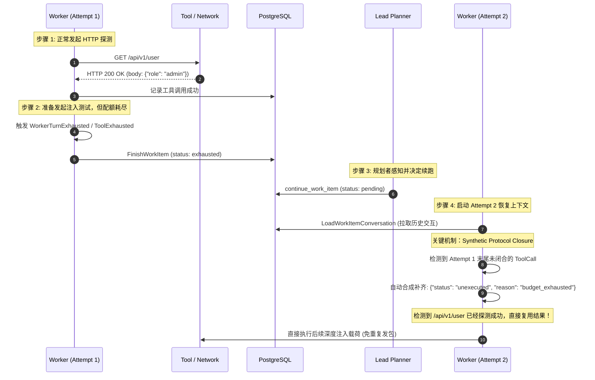
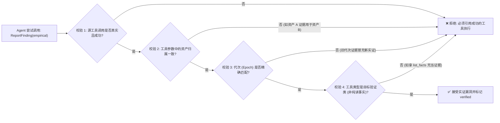
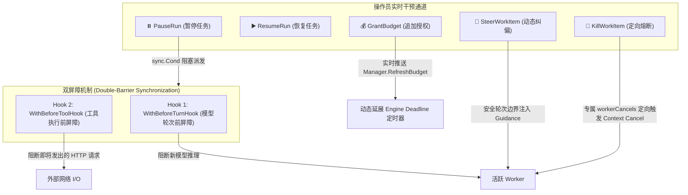

# 工业级自主攻防 Agent：核心架构解密与工程落地实践

> **分享定位**：面向技术团队、AI 架构师与安全研究员的技术分享材料。  
> **核心宗旨**：拒绝“套壳 Demo / 泛泛而谈”，深入剖析复杂攻防场景下多智能体协同、长任务推进、证据保真与受控执行的核心机制与深水区工程实践。

---

## 演讲总览与核心问题意识

```
┌────────────────────────────────────────────────────────────────────────┐
│ 核心命题：                                                             │
│ 为什么大部分自主渗透 Agent 只能停留在“自动化脚本/网页总结器”阶段？    │
│ 要让 Agent 在开放、高对抗、长周期的攻防场景中持续作战，               │
│ 必须跨越哪些架构鸿沟？                                                 │
└────────────────────────────────────────────────────────────────────────┘
```

### 传统“玩具 Agent”的五大死穴
1. **单一线性流水线**：抓取 URL $\rightarrow$ 调固定检查 $\rightarrow$ 人工看报告。Agent 没有“假设-验证-衍生新意图”的自主探索能力。
2. **上下文灾难与预算熔断**：任务跑几轮后 Token 撑爆，或 Worker 局部配额耗尽直接导致全任务崩溃，无法跨 Attempt 连续推进。
3. **“幻觉型漏洞”与伪证据**：模型看到 200 响应就声称发现注入，或将资产 A 的成功请求作为资产 B 存在漏洞的证据。
4. **日志孤岛与重复踩坑**：并发 Worker 各跑各的，无法按需检索其他 Worker 的中间探索轨迹，频繁发起重复探测。
5. **人在环路（HITL）流于表面**：只能在最后点“确认/忽略”，无法在运行时动态纠偏（Steer）、暂停（Pause）、精准定点熔断（Kill）或动态续命。

---

## 一、 认知底座：从“链接拓扑”走向“双图因果推理”

在攻防对抗中，单纯维护一张网页链接的拓扑树（Link Graph）是远远不够的。本项目参考 ARTEX 设计，实现了**资产图（Asset Graph）**与**探索图（Exploration Graph）**解耦的双图底座。



### 关键设计精要：
1. **物理实体 vs 认知实体分离**：
   - **资产图**关注物理身份与安全范围（Scope）：归一化 URI、主机、端口、协议，严格限制无授权探测。
   - **探索图**关注认知推理血缘：以 `Goal`（最终交付物）、`Fact`（可复用事实）、`Hint`（线索假设）、`Intent`（行动意图）、`Finding`（发现）为节点。
2. **事实置信度降级机制（Anti-Hallucination Fact Gate）**：
   - 事实分为 `observed`（直接观察）与 `inferred`（推断猜测）。
   - **硬规则**：只有具备真实成功的工具调用（`source_tool_call_id`）或可信观察（`source_observation_id`）的事实才能打上 `verified` 标签；纯文本自述或缺少确证来源的一律降级为 `unverified`。
3. **目标证明闭环（Goal Proof）**：
   - 传统的“工作队列清空即结项”在真实场景是伪命题。
   - 系统提供 `prove_goal` 工具：只有处于 `verified` 状态的实证事实或漏洞才能证明目标；`suggest_completion` 强制校验所有目标达成状态，杜绝 Agent“偷懒提前跑路”。

---

## 二、 记忆模型解耦：非对称运行时（Asymmetric Memory Model）

多 Agent 架构最容易犯的错误就是**“所有 Agent 共用一套会话历史”**，这会导致巨量噪音和上下文爆炸。

```
┌────────────────────────────────────────────────────────────────────────┐
│                     非对称记忆架构设计对比                             │
├───────────────────┬────────────────────────────────────────────────────┤
│ 角色              │ 核心诉求与记忆设计机制                             │
├───────────────────┼────────────────────────────────────────────────────┤
│ 主规划者          │ • 宏观视野，负责全局态势感知与意图拆解             │
│ (Lead Planner)    │ • 每轮开启全新独立 Session，不读所有旧对话         │
│                   │ • 只喂入：双图最新态势 + 事件变动 + 共享待办      │
│                   │ • 跨轮记忆依托：持久化 PlannerTodo 表              │
├───────────────────┼────────────────────────────────────────────────────┤
│ 执行工蜂          │ • 微观深度，负责具体方向的深度渗透与漏洞利用       │
│ (Domain Worker)   │ • 维护单一意图的跨 Attempt 连续对话历史            │
│                   │ • 局部超限收尾后，重跑恢复历史，避免重复发网络请求 │
│                   │ • 跨工作协作：通过 Trace 过程检索工具按需查阅      │
└───────────────────┴────────────────────────────────────────────────────┘
```

---

## 三、 深水区攻坚：长任务会话恢复与“合成协议闭合”

当一个复杂漏洞利用需要执行 15 步交互，而单轮 Worker 的配额（如限制最多 5 轮交互）耗尽时，传统系统直接报错或从头来过。本项目实现了**多 Attempt 会话恢复与协议闭合体系**。



### 核心工程细节：为什么需要“合成协议闭合（Synthetic Protocol Closure）”？
- **OpenAI / Claude 协议铁律**：在请求历史中，只要 Assistant 发出了一个 `tool_calls`，后面必须紧跟一条 `role: "tool"` 且携带相同 `tool_call_id` 的消息；否则直接报错 `400 Invalid parameter: tool_calls must be followed by tool results`。
- **痛点**：Worker 在第 5 轮决定调用工具的同时触碰了额度熔断（Hard Budget Cap），该工具根本没被真正执行就强制进入了收尾退出（Settlement）。
- **解法**：在加载历史构造第二轮对话时，运行时自动识别孤儿 `tool_call`，在历史末尾合成一个标准 Tool Result（标注 `unexecuted`），既满足了 LLM 厂商的严苛协议规范，又把“上轮未执行”的真实上下文无缝传递给了下一任 Worker。

---

## 四、 跨智能体协作：过程级 Trace 检索而非结果汇总

大部分 Agent 协作仅靠“Agent A 写一段几十字的 Summary 存数据库，Agent B 读 Summary”。这在攻防场景完全不够用，因为**渗透测试的关键细节往往藏在原始 HTTP 响应头、未识别的隐藏字段、异常堆栈或中间报错信息中**。

```
传统方式：
Worker A -> "尝试了 SQL 注入，未成功。" (信息丢失 99%)

本项目机制：
Worker B 随时调用 `search_all_worker_traces` 或 `get_worker_trace`：
- 关键字搜索: "error in SQL syntax" 或 "Set-Cookie"
- 精确到 Step 的结构化交互详情（参数、响应、抓包指针）
- 结果：Worker B 发现 Worker A 在探测某接口时服务端爆出的绝对路径 /var/www/html/app.py，直接利用该路径打 LFI 本地文件包含。
```

---

## 五、 防作弊实证契约：真实验证防御矩阵

为了防止 Agent “虚报战功”或“把无关证据张冠李戴”，系统建立了一整套严格的后端数据约束与前置校验矩阵：



### 独立复测执行器（Retest Executor）的结构化裁决
复测漏洞是否被修复时，**坚决不使用 LLM 自由文本子串匹配（如出现 'fixed' 就当修复）**：
1. **独立启动**：`POST /api/runs/.../retests` 由后台独立的 Verifier 会话执行，与原 Worker 隔离。
2. **结构化特征比对**：
   - 必须有本次复测会话发出的真实 HTTP 工具调用；
   - 提取真实响应状态码与响应体特征（如原先泄露的密钥在响应体中消失，且返回 403 Forbidden）；
   - 若无工具调用、工具调用失败、或内容被截断，一律判定为 `inconclusive`，绝不武断判定 `fixed`；
   - 100% 保护现有人工审核历史与时间戳，审计轨迹不可逆。

---

## 六、 生产级受控执行与人在环路（HITL）

工业级系统必须赋予操作员“掌控一切”的能力，而不仅是放任 Agent 自由漫步。



### 核心并发治理：PostgreSQL 死锁（40P01）根治
在高并发多 Worker + 操作员实时干预（Pause / Steer / Retest）的复杂场景下，多表交叉更新极易引发数据库死锁。
- **强制全局锁序**：
  $$\text{runs (FOR UPDATE)} \longrightarrow \text{work\_items / findings / retests (FOR UPDATE)} \longrightarrow \text{run\_events / agent\_tool\_calls}$$
- **实践效果**：在全库 166 秒的 `-race` 竞态压力测试下，零死锁、零竞态冲突。

---

## 七、 技术分享的核心总结与架构启示

### 1. 软件工程第一定律在 Agent 系统的体现
> **LLM 是概率机器，但攻防系统必须是确定性系统。**
- 提示词（Prompt）只能指导行为倾向，**永远不能代替后端在范围（Scope）、权限、预算与证据链上的代码级强校验**。

### 2. 状态机与持久化是长任务生命线
- 任务执行必须拥有清晰的代次（Epoch）、工作项（WorkItem）、尝试（Attempt）与会话（Session）层次；
- 失败收尾（Settlement）、断点恢复、协议兼容闭合必须在一开始就设计为一等公民，而不是事后打补丁。

### 3. 多 Agent 协作的关键是“信息流动”，而非“层级汇报”
- 传统的多层汇报机制会导致严重的上下文信息丢失；
- 建立共享知识图谱（双图）与细粒度过程索引（Trace 检索），让每个 Agent 在需要时能“看透全局物理拓扑与微观探测细节”，才是真正的高效协同。

---

## 附：周五分享演讲节奏与 PPT 页面规划建议

| 时间 | 模块 | 核心讲解重点 | 演示 / 互动建议 |
| :--- | :--- | :--- | :--- |
| **00-05 min** | **引子与痛点** | 为什么网上的 AutoGPT/攻防 Demo 一跑就崩？展示 5 大现实死穴。 | 抛出问题：“如果一个漏洞需要 15 步交互，你该怎么设计 Agent？” |
| **05-15 min** | **双图架构** | 物理资产图 vs 认知探索图；事实置信度与目标证明。 | 结合 Mermaid 图，讲解因果链条（Derived $\rightarrow$ Yields $\rightarrow$ Proves）。 |
| **15-25 min** | **会话恢复与长任务** | 重点剖析 Attempt 会话恢复与**合成协议闭合（Synthetic Tool Closure）**。 | 展示为什么大模型 API 会报 400 错误，我们如何优雅解决。 |
| **25-35 min** | **证据防作弊与复测** | 资产一致性校验、代次隔离、独立复测执行器的确定性判定。 | 展示反例测试（如用 A 网站的 200 证明 B 网站漏洞被拦截）。 |
| **35-42 min** | **人在环路与控制面** | 双屏障暂停（阻止物理发包）、动态预算延展、锁序治理。 | 讲解如何用 Go `sync.Cond` 与 Context 树实现微秒级受控拦截。 |
| **42-45 min** | **Q & A** | 回答关于 Token 消耗、对抗场景下稳定性等问题。 | 总结核心金句。 |
