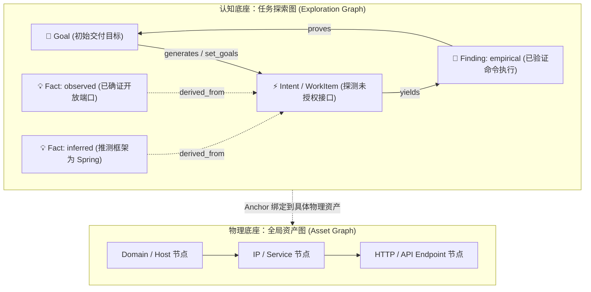
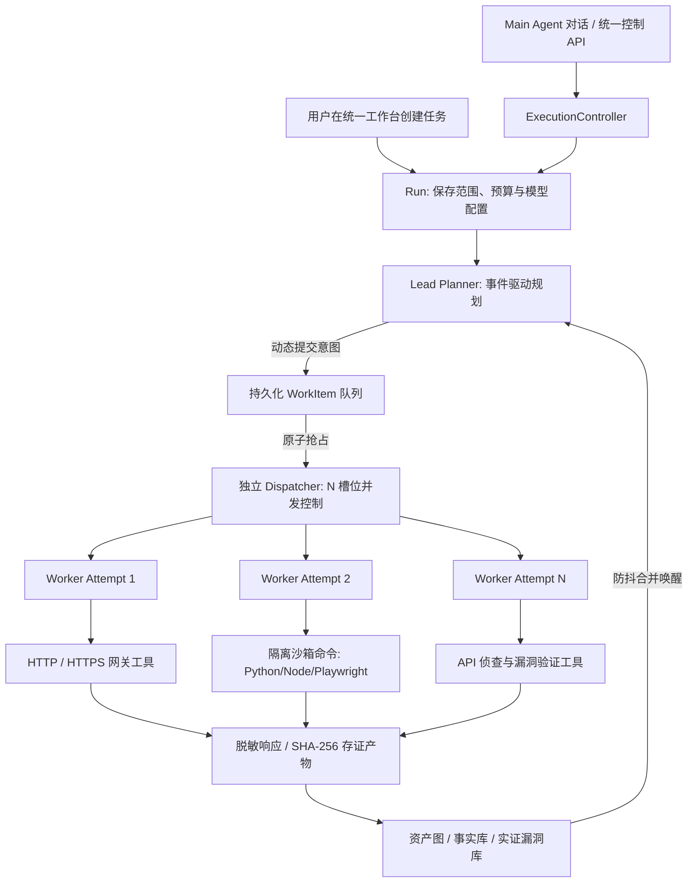
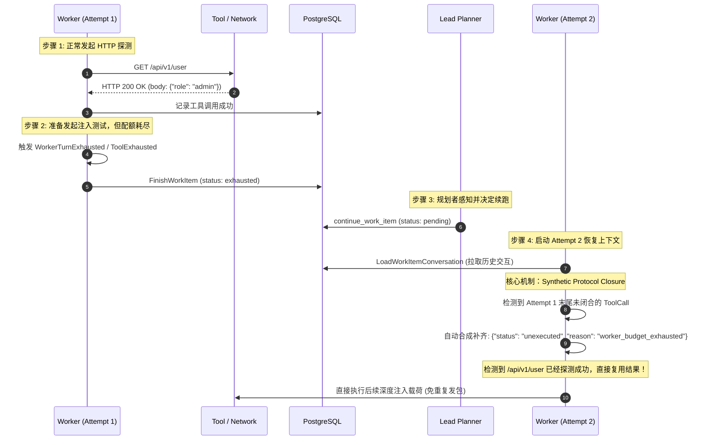
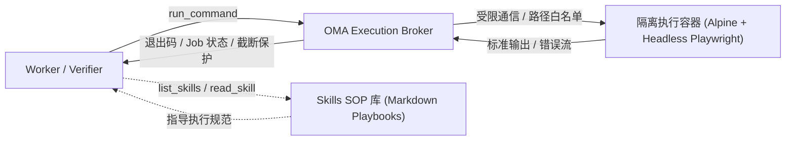
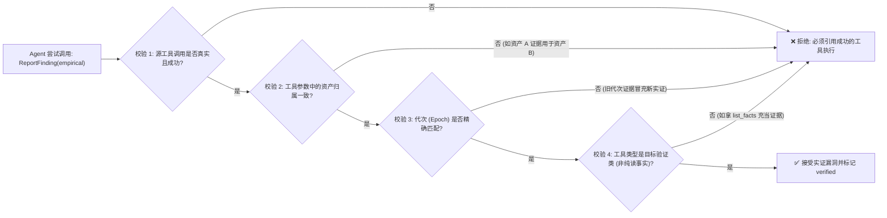

# 工业级自主攻防 Agent：核心架构解密与工程落地实践

> **分享定位**：面向技术团队、AI 架构师与安全研究员的技术分享材料（实战进阶版）。  
> **核心宗旨**：拒绝“套壳 Demo / 泛泛而谈”，深入剖析复杂攻防场景下多智能体协同、长任务推进、证据保真、隔离执行与受控交互的底层机制，以及一线踩坑的硬核工程经验。

---

## 演讲总览与核心问题意识

```
┌────────────────────────────────────────────────────────────────────────┐
│ 核心命题：                                                             │
│ 为什么大部分自主渗透 Agent 只能停留在“自动化脚本/网页总结器”阶段？    │
│ 要让 Agent 在开放、高对抗、长周期的攻防场景中持续作战，               │
│ 必须跨越哪些核心架构鸿沟？                                             │
└────────────────────────────────────────────────────────────────────────┘
```

### 传统“玩具 Agent”的五大死穴
1. **单一线性流水线**：抓取 URL $\rightarrow$ 调固定检查 $\rightarrow$ 人工看报告。Agent 缺乏“假设-验证-衍生新意图”的自主因果推理能力。
2. **上下文灾难与预算熔断**：任务跑几轮后 Token 撑爆，或 Worker 局部配额耗尽直接导致全任务崩溃，无法跨 Attempt 连续推进。
3. **“幻觉型漏洞”与伪证据**：模型看到 200 响应就声称发现注入，或将资产 A 的成功请求作为资产 B 存在漏洞的证据；前端为了视觉美化甚至伪造“已证明”连线。
4. **日志孤岛与重复发包**：并发 Worker 各跑各的，无法按需检索其他 Worker 的中间网络流量与探索轨迹，频繁发起重复探测，甚至打草惊蛇。
5. **人在环路（HITL）流于表面**：只能在最后点“确认/忽略”，无法在运行时动态纠偏（Steer）、双屏障暂停（Pause）、定点熔断（Kill）或动态续命。

---

## 一、 认知底座：物理资产图 vs 认知探索图（双图架构）

在攻防对抗中，单纯维护一张网页链接的拓扑树（Link Graph）是远远不够的。本项目参考 ARTEX 设计，实现了**资产图（Asset Graph）**与**探索图（Exploration Graph）**解耦的双图底座。



### 关键设计精要：
1. **物理实体 vs 认知实体分离**：
   - **资产图**关注物理身份与安全范围（Scope）：归一化 URI、主机、端口、协议，严格施加范围授权检查（Scope Gate），防止未授权越界扫描。
   - **探索图**关注认知推理血缘：以 `Goal`（最终交付物）、`Fact`（可复用事实）、`Hint`（线索假设）、`Intent`（行动意图）、`Finding`（实证发现）为节点。
2. **事实置信度降级机制（Anti-Hallucination Fact Gate）**：
   - 事实分为 `observed`（直接观察）与 `inferred`（推断猜测）。
   - **硬规则**：只有具备真实成功的工具调用（`source_tool_call_id`）或可信观察（`source_observation_id`）的事实才能打上 `verified` 标签；纯文本自述或缺少确证来源的一律降级为 `unverified`。
3. **目标证明闭环（Goal Proof）**：
   - 传统的“工作队列清空即结项”在真实场景是伪命题。
   - 系统提供 `prove_goal` 工具：只有处于 `verified` 状态的实证事实或漏洞才能证明目标；`suggest_completion` 强制校验所有目标达成状态，杜绝 Agent“偷懒提前跑路”。

---

## 二、 运行架构：解耦的 Lead Planner 与真正的 N Worker 并发

过去许多多 Agent 系统在派工时由于规划阻塞，往往退化成了“伪多 Agent、实单 Worker 串行”。本项目彻底实现了规划、派发与执行的三权分立：



### 1. 非对称记忆架构（Asymmetric Memory Model）
- **Lead Planner（宏观视野）**：
  - 负责全局态势感知与意图拆解；
  - **每轮开启全新独立 Session**，坚决不回放全体旧对话，避免上下文无限膨胀；
  - 仅喂入：双图最新态势 + 防抖合并变动事件 + 跨轮持久化待办（`planner_todos` 表）。
- **Domain Worker（微观深度）**：
  - 负责具体方向的深度渗透与漏洞利用；
  - 维护单一意图跨 Attempt 的连续对话上下文；
  - 配额耗尽收尾后，重跑恢复历史，避免重复发外部请求。

### 2. 共享模型准入池（Shared Model Admission）
- 多 Worker 并行如果各调各的 API，瞬间就会打爆上游 LLM 的 RPM / TPM 限制，甚至导致 Planner 无法获得槽位进行监督调度。
- 服务内构建共享 Token Bucket 信号量池，并为 Planner 预留高优先级通道，确保突发并发下规划中枢永不饥饿。

---

## 三、 核心工具矩阵：多角色协同与分层能力契约（Tooling Matrix）

> **设计准则**：不要把所有工具塞给所有 Agent，也不要把参数自由度无限制抛给 LLM。工具是 Agent 与物理环境交互的唯一触手，必须**按角色授权、按阶段加载、严格校验参数与返回结构**。

```
┌────────────────────────────────────────────────────────────────────────┐
│                        多角色工具授权矩阵                              │
├────────────────────┬───────────────────────────────────────────────────┤
│ 角色 / Profile     │ 核心工具集（Tool Set）                            │
├────────────────────┼───────────────────────────────────────────────────┤
│ Lead Planner       │ submit_plan, add_intent, continue_work,           │
│ (规划与监督中枢)   │ retry_work, steer_work, kill_work, set_goals,     │
│                    │ list_goals, prove_goal, suggest_completion,       │
│                    │ list_worker_traces, get_worker_trace,             │
│                    │ search_all_worker_traces, manage_planner_todos,   │
│                    │ graph_overview, node_detail, list_run_assets      │
├────────────────────┼───────────────────────────────────────────────────┤
│ Domain Worker      │ • 网络与流量: http_request, search_http_traffic,  │
│ (领域执行工蜂)     │   get_http_exchange, read_artifact, get_endpoint  │
│ (按 Profile 挂载)  │ • 资产侦查: extract_endpoint_links,               │
│                    │   extract_api_endpoints, register_asset           │
│                    │ • 沙箱执行: run_command, write_file, read_file,   │
│                    │   inspect_command                                 │
│                    │ • 知识提报: record_observation, record_fact,      │
│                    │   report_finding, run_security_check              │
│                    │ • 领域技能: list_skills, read_skill               │
├────────────────────┼───────────────────────────────────────────────────┤
│ Main Agent         │ steer_work_item, kill_work_item, pause_run,       │
│ (人机对话控制面)   │ resume_run, grant_budget, create_finding_retest   │
├────────────────────┼───────────────────────────────────────────────────┤
│ Verifier           │ http_request, read_artifact (专用复测执行)        │
│ (独立复测执行器)   │ 严禁挂载知识自述类工具，杜绝凭空捏造 fixed 结论   │
└────────────────────┴───────────────────────────────────────────────────┘
```

### 五大核心工具簇深度解析

#### 1. 规划监督与认知管理簇（Planning & Knowledge Tools）
* **`submit_plan` / `add_intent`**：Planner 向 Frontier 队列提交结构化意图（WorkItem），显式绑定锚定资产、前置依赖与预期目标。
* **`continue_work` / `retry_work`**：Worker 局部超限或受阻后，Planner 有依据地将工作项重置为 `pending`，由 Dispatcher 原子分配 Attempt N+1。
* **`steer_work` / `kill_work`**：Planner 主动监督介入正在运行的 Worker，下发针对性指引或熔断无价值分支。
* **`set_goals` / `list_goals`**：将用户宏观任务（如“尽可能挖掘漏洞”）拆解为可量化验收的阶段性 Goal 节点。
* **`prove_goal`**：强校验工具。必须传入状态为 `verified` 的 Fact ID 或 Finding ID，将对应 Goal 标为 `met`。
* **`manage_planner_todos`**：对标 ARTEX TodoStore，提供跨轮次持久化待办便签增删改查，解耦单轮 Session 上下文。

#### 2. 网络探测与透明流量复用簇（Network & Traffic Tools）
* **`http_request`**：企业级网络网关工具。严格校验同源范围（Scope Gate），支持完整 HTTP/HTTPS 协议参数，透明截获请求/响应头及正文，计算 SHA-256 并生成权威收据 `receipt_id`。
* **`search_http_traffic`**：**零网络 I/O 检索工具**。支持按 Host、Method、状态码、Epoch、URL 模糊搜索同 Run 捕获的流量索引，返回 `receipt_id` 与正文产物指针。
* **`get_http_exchange`**：根据 `receipt_id` 提取已脱敏的完整交互报文。标记 `new_verification=false`，仅供分析推断，不可伪装为当前漏洞实证。
* **`read_artifact`**：针对大体积 HTTP 响应正文，按 UTF-8 安全字符偏移量进行分页切片读取，防止单次工具调用打爆 Token 上下文。

#### 3. 资产侦查与代码挖掘簇（Reconnaissance & Discovery Tools）
* **`extract_endpoint_links`**：解析已成功请求的 HTML 页面，自动抽取同源页面链接、更新爬取深度，并将新发现端点自动沉淀至物理资产图。
* **`extract_api_endpoints`**：针对前端静态 JS 脚本或 HTML 内联代码，利用高精度正则萃取 RESTful API 路由、后端参数及接口路径，打破传统爬虫无法触达动态 API 的盲区。
* **`register_asset`**：允许 Worker 显式注册经过规范化去重（URI Normalization）的新型资产（Domain/Host/Service/Endpoint）。

#### 4. 沙箱容器与命令执行簇（Sandboxed Command Tools）
* **`run_command`**：受控命令执行工具。通过 OMA Execution Broker 调度至独立的 Docker 容器沙箱内运行。命令白名单限制（`python3`, `curl`, `node`, `playwright-cli`），超时自动熔断，标准输出/错误流完整记账。
* **`write_file` / `read_file`**：严格限定在隔离工作区相对路径下的安全文件读写，用于放置 PoC 脚本、临时字典或捕获日志。
* **`inspect_command`**：异步长任务状态查询工具，支持轮询后台任务退出码与执行进度。

#### 5. 实证漏洞与技能剧本簇（Finding & Skills Tools）
* **`report_finding`**：实证漏洞提报工具。支持声明 `empirical`（实证）与 `speculative`（推测）。在实证模式下必须附带：
  * `source_tool_call_id`：真实成功的底层工具调用 UUID；
  * `traffic_refs`：结构化收据引用，明确标注请求角色（`baseline` 正常基线、`proof` 漏洞触发载荷、`verification` 二次确证）；
  * `verification`：精确的 HTTP 状态码与响应体特征谓词。
* **`list_skills` / `read_skill`**：SOP 知识库工具。Agent 根据当前目标按需加载 `api-recon`（API 探测手册）、`finding-verification`（证据对齐契约）、`playwright-cli`（浏览器无头自动化 SOP），实现知识的轻量化按需调阅。

### 能力配置文件（Capability Profiles）机制
系统不将所有工具一股脑全量暴露，而是依据任务模式切分为标准 Profile，将模型注意力集中在核心动作上：
* **`explore`**：只读网络 + 页面链接/API 静态挖掘 + 事实记录 + 技能查阅（标准探测）；
* **`api_recon`**：流量检索 + API 端点深度提取 + 观察提报（聚焦隐藏接口）；
* **`active_probe`**：全功能 `http_request` + 流量复用 + 沙箱命令 + 实证漏洞提报（深度渗透利用）；
* **`browser`**：无头浏览器 Playwright 驱动（处理复杂前端渲染与登录认证交互）。

---

## 四、 深水区攻坚：长任务会话恢复与“合成协议闭合”

当一个复杂漏洞利用需要执行 15 步交互，而单轮 Worker 的局部配额（如限制最多 5 轮交互）耗尽时，传统系统直接报错或从头来过。本项目实现了**多 Attempt 会话恢复与协议闭合体系**。



### 为什么需要“合成协议闭合（Synthetic Protocol Closure）”？
- **大模型底层协议铁律**：在请求历史中，只要 Assistant 发出了一个 `tool_calls`，后面必须紧跟一条 `role: "tool"` 且携带相同 `tool_call_id` 的消息；否则 OpenAI / Anthropic 会直接报错：`400 Invalid parameter: tool_calls must be followed by tool results`。
- **痛点**：Worker 在第 5 轮决定调用工具的同时触碰了额度熔断（Hard Budget Cap），该工具根本没被真正执行就强制进入了收尾退出（Settlement）。
- **解法**：在加载历史构造第二轮对话时，运行时自动识别孤儿 `tool_call`，在历史末尾合成一个标准 Tool Result（标注 `unexecuted`），既满足了 LLM 厂商的严苛协议规范，又把“上轮未执行”的真实上下文无缝传递给了下一任 Worker。

---

## 五、 跨智能体协作升级：共享 HTTP 流量与材料复用

很多团队以为多 Agent 协作就是“Agent A 写一段 50 字 Summary 存数据库，Agent B 读这段话”。但在攻防实战中，这种方式会导致 **99% 的关键信息丢失**。

```
传统方式的致命缺陷：
Worker A -> "尝试了某登录接口，返回了 500 报错。" (丢失了 Cookie、异常堆栈和参数结构)

本项目落地机制 (Shared HTTP Traffic)：
```

1. **流量存证与稳定收据（Receipt & Artifact）**：
   - 所有 Worker 发起的 HTTP(S) 请求均由统一网关透明捕获，记录脱敏请求/响应头，并对完整正文计算 SHA-256 后存为受控产物（Artifact）。
   - 产生稳定全局唯一的 `receipt_id`。
2. **只读材料检索工具集**：
   - `search_http_traffic`：支持按 Host、Method、状态码、Epoch、URL 模糊匹配等进行轻量检索；
   - `get_http_exchange`：通过 `receipt_id` 读取包含完整响应、脱敏凭据的交互切片；
   - `read_artifact`：针对长正文进行 UTF-8 安全的分页读取。
3. **协作场景**：
   - Worker A 在探测首页时抓到了包含敏感接口路由的 HTML；
   - Worker B（负责 API 渗透）无需再次向目标服务器发包，直接通过 `get_http_exchange` 获取 Worker A 的捕获结果，解析前端 JS 路由，**实现真正的零冗余协同，极大幅度降低对目标靶场的轰炸频次**。
4. **防作弊铁律**：通过流量检索读取的历史材料，系统自动打标 `new_verification=false`，**坚决不能作为 Worker 证明当前漏洞存在的依据**！

---

## 六、 沙箱隔离与领域技能（Skills）体系

为了突破单一 Web 请求的限制，让 Agent 具备执行 Python 脚本、Playwright 浏览器自动化与特定漏洞 PoC 的能力，必须引入**受控执行容器**与**SOP 技能包**：



1. **执行容器隔离（Execution Broker）**：
   - 严苛的命令白名单（`NormalizeArgv`）：仅允许 `/usr/local/bin/python3`、`/usr/bin/curl`、`/usr/local/bin/node`、`/usr/local/bin/playwright-cli`；
   - 禁止在宿主机直接跑命令，所有执行落入受限容器沙箱，通过不可篡改的环境变量与网络策略管控；
   - 退出码与输出完整记账，支持异步 Cancel 与超时熔断。
2. **领域技能树（Skills System）**：
   - 落地 `skills/api-recon`（API 资产与端点探测标准流程）；
   - 落地 `skills/finding-verification`（实证漏洞验证与 HTTP 证据对齐契约）；
   - 落地 `skills/playwright-cli`（无头浏览器深度交互指引）；
   - Agent 通过 `list_skills` 了解可用剧本，通过 `read_skill` 按需加载 SOP，避免提示词超长，实现“知识按需拉取”。

---

## 七、 防作弊实证契约与独立复测执行器

为了防止 Agent “虚报战功”或“把无关证据张冠李戴”，系统建立了一整套严格的后端数据约束与前置校验矩阵：



### 独立复测执行器（Retest Executor）的结构化裁决
复测漏洞是否被修复时，**坚决不使用 LLM 自由文本子串匹配（如模型输出里包含 'fixed' 就当修复）**：
1. **独立拉起**：`POST /api/runs/.../retests` 由后台独立的 Verifier 会话执行，与原发现 Worker 完全隔离。
2. **结构化特征比对**：
   - 必须绑定本次复测会话发出的真实 HTTP 工具调用；
   - 提取真实响应状态码与响应体特征（例如原先泄露的密钥在响应体中消失，且返回 403 Forbidden）；
   - 若无工具调用、工具调用失败、或内容被截断，一律判定为 `inconclusive`，绝不武断判定 `fixed`；
   - 100% 保护现有人工审核历史与时间戳，审计轨迹不可逆。

---

## 八、 那些写在代码深水区的“硬核教训”（Hard-Earned Lessons）

在真实测试与生产落地中，踩过的坑往往比成功的架构更有参考价值：

### 1. UTF-8 汉字截断惨案：512 字节引发的数据库崩溃
- **现象**：在真实中文靶场上，很多页面虽然返回了 HTTP 200，但后续链接提取和持久化全部失败，Agent 提前停止。
- **根因**：脱敏模块在提取正文预览时写了 `body[:512]`。由于中文字符在 UTF-8 下占 3 个字节，切片恰好切在第 2 个字节中间，产生了一个残缺非法的 byte 序列。该字符串插入 PostgreSQL 报错：`invalid byte sequence for encoding "UTF8"`，事务回滚！
- **修复**：**必须按 Unicode Rune 边界做字符截断**，并在持久化前进行字符合法性兜底。

### 2. 工具 Panic 隔离机制：一个除以零不应该毁掉整个 Run
- **教训**：工具函数在解析复杂的畸形 HTML、非标准 JSON 时，可能偶发空指针或数组越界 panic。如果直接崩溃，Goroutine 死亡会导致整个 Run 悬空。
- **解法**：在 `tools.Registry` 统一包装 `guardPanic`。所有工具的 Validate 与 Execute 均在 recover 保护下运行。发生 panic 时，将错误堆栈记录在服务日志中，同时向模型返回结构化失败，并**安全生成 failed tool_call 记录**，确保模型轮次的协议成对闭合。

### 3. 前端画板（Canvas）的真实性审查：警惕“UI 欺骗”
- **教训**：在最初的前端探索链路画板中，开发人员为了连线好看，在代码里写了默认规则：如果 Finding 没有关联 Goal，就自动连一条 `proves` 线到第一个 Goal；如果 Fact 找不到来源，就默认挂到第一个 Intent。
- **反思**：**这是 Agent 系统中最大的隐形毒瘤**。用户在界面上看到了密密麻麻的“证明连线”，以为漏洞已被确认、目标已被证明，但后端数据库里实际上全都是 `unverified`！
- **准则**：**界面连线必须严格忠实于底层的因果血缘（`derived_from`, `yields`, `proves`）**。后端没有真实证明，画板上一根虚线都不准连！

### 4. PostgreSQL 事务加锁顺序与死锁（40P01）根治
- **现象**：当多 Worker 并发写入发现，同时操作员在界面上点击 Pause / Steer 时，数据库频繁爆发 `pq: deadlock detected`。
- **解法**：彻底重构加锁顺序，严格规范行锁获取次序：
  $$\text{runs (FOR UPDATE)} \longrightarrow \text{work\_items / findings / retests (FOR UPDATE)} \longrightarrow \text{run\_events / tool\_calls}$$
  在全库 166 秒 `-race` 竞态压力测试下，达成零死锁、零并发竞态冲突。

---

## 九、 技术分享总结与核心金句

### 1. 软件工程第一定律在 Agent 系统的体现
> **“LLM 是高度概率化的决策大脑，但工程底座必须是 100% 确定性的闭环骨架。”**
- 提示词（Prompt）只能指导行为意图，**永远不能代替后端在范围（Scope）、权限、预算与证据链上的代码级强校验**。

### 2. 会话状态与持久化是长任务的生命线
- 任务执行必须拥有清晰的代次（Epoch）、工作项（WorkItem）、尝试（Attempt）与会话（Session）层次；
- 失败收尾（Settlement）、断点恢复、协议兼容闭合必须在一开始就设计为一等公民，而不是事后打补丁。

### 3. 多 Agent 协作的关键是“信息共享”，而非“层级汇报”
- 传统的多层汇报机制会导致严重的上下文信息丢失；
- 建立共享知识底座（双图）与全量流量存证索引（Shared HTTP Traffic），让每一个 Agent 在需要时能“看透全局物理拓扑与微观探测细节”，才是真正的高效协同。

---

## 附：周五分享演讲节奏与 PPT 规划建议（45 分钟标准）

| 时间 | 模块 | 核心讲解重点 | 演示 / 互动建议 |
| :--- | :--- | :--- | :--- |
| **00-05 min** | **引子与痛点** | 为什么网上的 AutoGPT/攻防 Demo 一跑就崩？展示 5 大现实死穴。 | 抛出互动：“如果一个漏洞利用需要 15 步交互，你该怎么设计 Agent？” |
| **05-12 min** | **双图架构与 N Worker** | 物理资产图 vs 认知探索图；真正解耦的派发器与共享模型准入池。 | 展示架构图，对比“网页链接拓扑”与“因果推理图”的本质区别。 |
| **12-20 min** | **核心工具矩阵** | **五大工具簇深度剖析**：规划控制、透明流量复用、API萃取、沙箱执行与实证提报。 | 展示 Capability Profile 工具裁剪机制与角色分工表。 |
| **20-28 min** | **长任务恢复与协议闭合** | 剖析 Attempt 会话恢复与**合成协议闭合（Synthetic Tool Closure）**。 | **全场核心亮点**：展示 OpenAI 报 400 错误的底层原因与优雅闭合方案。 |
| **28-34 min** | **流量复用与容器隔离** | 共享 HTTP 流量机制（零冗余发包）；Execution Broker 沙箱与 Skills SOP。 | 解释为什么 Agent 不能只靠几十字的 Summary 汇报，而是需要原始请求材料。 |
| **34-40 min** | **硬核踩坑实录** | 剖析 UTF-8 字节截断、工具 Panic 兜底、前端画板“伪造连线”的反思、死锁治理。 | **最具工程师共鸣环节**：分享真实的 Bug 堆栈与反思。 |
| **40-45 min** | **总结与 Q & A** | 回顾三大定律，回答听众关于 Token 预算、防误报等实际问题。 | 亮出核心金句收尾。 |
