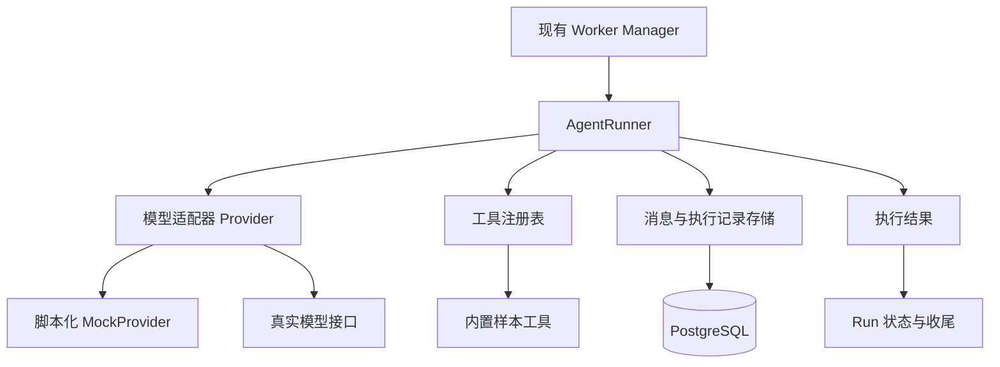

# 第二课：Agent 运行时与工具调用循环

> 日期：2026-10-19（Asia/Shanghai）  
> 项目：`oh-my-offensive-agent`  
> 前置基础：Task、Run、RunEvent、执行输入快照、停止收尾、数据库迁移与隔离测试。  
> 状态：课程设计与待实现任务。本课没有修改业务代码，没有调用真实模型，没有第二阶段测试结果。

## 1. 本课的交付目标

把固定执行十步的 FakeWorker 扩展为一个有限的 Agent 执行器：

```text
读取本次 Run 的目标与输入快照
→ 请求模型
→ 接收回答或工具请求
→ 程序校验并执行工具
→ 把工具结果交回模型
→ 继续判断或输出最终回答
```

练习任务：读取全部内置 HTTP 响应样本，汇总状态码和页面标题；报告区分实际观察与待验证推测，并引用样本 ID。

三个固定样本可以分别模拟首页、登录页和健康检查接口。样本内容由项目内置，不访问真实网站。工具循环、状态管理与持久化采用真实实现。

本阶段继续使用单个 Agent、非流式模型请求、串行工具执行、前端轮询。Planner、多 Worker、Shell、浏览器、MCP、网络工具和流量代理在后续课程实现。

## 2. 先明确：模型返回请求，程序负责执行

模型可以提出：读取样本 `login_page`。外围程序必须完成工具查找、参数校验、执行、记录结果，再把结果交回模型。

模型生成的“已读取页面”是一段文本；只有实际执行记录才能证明工具运行过。

这种由应用执行函数、把结果交回模型的方式是 function calling 的基本机制。[OpenAI 官方工具调用指南](https://developers.openai.com/api/docs/guides/function-calling)

## 3. 新增模块与现有模块的关系



| 模块 | 职责 | 边界 |
| --- | --- | --- |
| Manager | 注册、启动、取消和等待执行器 | 不解析供应商响应，不承担模型循环 |
| AgentRunner | 循环顺序、工具分发、预算与结果 | 不在循环主体硬编码某家接口字段 |
| Provider | 模型请求、响应、错误和用量的适配 | 不执行工具，不直接修改 Run 状态 |
| ToolRegistry | 工具名称、描述、参数约束与处理函数 | 只允许注册过的工具 |
| Store | 保存消息、模型调用、工具调用和事件 | 网络请求期间不持续持有数据库事务或行锁 |
| 生命周期收尾 | 将执行结果映射为 Run 状态、原因和最终输出 | 终态保护、停止规则继续有效 |

Manager 应能通过统一执行器边界启动 FakeWorker 或 AgentRunner，避免复制两套停止和等待逻辑。

## 4. 用一条完整记录理解运行时

假设用户目标是读取三个样本并汇总：

| 顺序 | 谁产生 | 内容 |
| --- | --- | --- |
| 1 | 程序 | 初始指令、用户目标、允许工具、执行限制 |
| 2 | 模型 | 请求 `list_samples`，调用 ID 为 call_a |
| 3 | 程序 | 执行工具，返回三个样本 ID，结果关联 call_a |
| 4 | 模型 | 请求读取三个样本，分别有独立调用 ID |
| 5 | 程序 | 按顺序执行三个调用，逐个返回对应结果 |
| 6 | 模型 | 根据样本输出最终报告 |
| 7 | 程序 | 保存最终输出，结束 Run |

工具调用 ID 是匹配请求与结果的依据。只有文本摘要而没有对应关系，无法可靠地重建后续模型输入。

以 Chat Completions 为例，工具结果使用 `tool_call_id` 对应先前的调用；应用还需要保留产生工具请求的 assistant 消息。模型参数需要应用校验。[官方协议参考](https://developers.openai.com/api/reference/resources/chat/subresources/completions/methods/create)

## 5. 内部接口：不要让业务依赖某家响应 JSON

概念上，一次模型调用接收：

- 已有会话条目。
- 本轮允许的工具定义。
- 输出限制、超时和模型配置。

返回：

- assistant 文本（可能为空）。
- 工具请求列表，每项带调用 ID、工具名称、原始参数。
- 结束原因：正常结束、请求工具、被截断、拒绝或异常。
- 供应商请求 ID、用量（如可用）和必要的协议附加信息。

一轮可能同时包含文本和多个工具请求。存在工具请求时，本轮文本不能直接作为最终答案。

本课的多工具请求按模型给出的顺序串行执行。正常情况下，完整处理该批调用、收齐结果后再请求模型。不要只取第一项，也不要在工具结果仍缺失时发起下一轮。

Provider 需要保留继续会话所需的供应商字段或不透明条目。尤其不能把某些推理模型的必要协议上下文丢弃后，仅留下最终文本。内部最小结构是业务视图，不应成为删除协议数据的理由。[官方工具调用指南](https://developers.openai.com/api/docs/guides/function-calling)

### 5.1 真实接口的范围

本课默认真实适配实现一种非流式 Chat Completions 兼容工具调用协议，使用明确支持该接口工具调用的模型。协议适配器与模型选择分开，不固定具体模型名。

如果用户最终选用的模型仅支持其他协议，就改为实现对应的一种 Provider。当前官方指南明确指出，部分模型的工具调用需要 Responses API。因此不能把“兼容 Chat Completions”当作所有模型均可使用的保证。[官方兼容性说明](https://developers.openai.com/api/docs/guides/function-calling)

实现 Agent 应先确认实际服务与模型支持的协议，再完成真实适配；本课不要求同时实现多套供应商协议。

## 6. 工具：先定义一个小而明确的能力集合

本课仅两个工具：

| 工具 | 输入 | 输出 |
| --- | --- | --- |
| list_samples | 空对象 | 三个内置样本的 ID 与简短说明，不提前返回正文 |
| read_sample | sample_id 字符串 | 样本 ID、状态码、响应头和固定正文 |

sample_id 必须来自固定注册集合，不解释为文件路径或 URL。样本正文中的文字属于被观察数据，不能用来修改执行器规则。

每个工具定义至少包括名称、用途、参数结构、必填项、输入上限和输出上限。

### 6.1 校验发生在调用之前

校验工具是否存在、参数是否为合法 JSON、类型和必填项是否正确、是否包含不允许的字段、样本 ID 是否有效。

校验失败时保存一条被拒绝的调用，返回带原调用 ID 的结构化错误。模型可以在下一轮修正，但仍受总调用预算限制。

未知工具不允许自动转成 Shell；正文中提到某个工具名称，也不能创建真实工具。

### 6.2 工具错误与系统错误分开

| 情况 | 本课处理 |
| --- | --- |
| 未知工具、参数错误、样本不存在 | 返回工具错误，允许模型有限修正 |
| 工具自身执行失败或超时 | 返回失败结果；若 Run 仍有效，可继续下一轮 |
| Provider 请求失败 | Run failed，保留原因，本课默认不自动重试 |
| Provider 返回无效协议结构 | Run failed，标记 protocol_error |
| 数据库写入失败 | 停止后续模型与工具操作，尝试有限收尾，故障恢复按既有策略处理 |
| 用户停止或 Run 总时间到期 | 不再启动下一项操作，执行取消与收尾 |

工具失败不一定代表整个 Run 必须失败。反过来，系统无法保存执行记录时，也不能继续无记录地执行。

## 7. 消息、调用记录和事件为什么分开

| 数据 | 用途 |
| --- | --- |
| 会话条目 agent_messages | 保存模型看到的指令、输入、assistant 请求与工具结果 |
| 模型调用 model_calls | 保存轮次、开始结束时间、状态、请求 ID、用量和错误 |
| 工具调用 tool_calls | 保存调用 ID、工具、参数、输出、状态和耗时 |
| RunEvent | 为用户展示时间线与业务进展 |
| Run 最终输出 | 保存本次回答，避免只能从日志中寻找结果 |

具体表名可以调整，但这些信息必须有明确归属。本课一个 Run 对应一个 Agent 会话，不需要引入会话分支或多 Agent 会话体系。

每条记录应关联 run_id；工具调用还应关联本轮模型调用。相同模型响应批次内的重复或缺失调用 ID 属于协议错误，应在执行该批工具前检查。

工具请求、调用开始、调用结果与终态都有明确状态。请求记录存在不代表工具成功执行。

### 7.1 保存顺序

```text
保存本次模型调用的开始记录
→ 发起网络请求（不占用数据库事务）
→ 保存 assistant 返回、调用结果和对应事件
→ 保存待执行工具请求
→ 检查停止与预算
→ 执行工具
→ 保存工具结果、对应会话条目和事件
→ 发起下一轮模型请求
```

最终回答与 Run 完成状态、完成事件一起提交；提交前仍需检查停止竞争。若 stopping 已先提交，就不能再标记 completed。

停止或预算耗尽可能使一批工具请求只执行一部分。此时保存已完成与未执行情况并结束 Run，不发送包含缺失工具结果的下一轮请求。

### 7.2 崩溃与历史

本课保留消息与过程用于查看，不实现崩溃后自动重放工具。重启时将遗留模型调用、工具调用和 Run 标记为中断，保留已有内容，避免子记录永久显示 running。

保存会话历史不自动等于支持安全恢复。恢复执行是后续需要单独定义的能力。

## 8. 退出规则与预算

以下是本项目的教学默认值，可以配置，实际值必须进入执行输入快照：

| 限制 | 默认值 | 计数定义 |
| --- | --- | --- |
| max_model_calls | 8 | 每次实际请求模型计一次 |
| max_tool_calls | 12 | 每条工具请求计一次，包含被拒绝请求 |
| run_timeout_seconds | 120 | 从执行开始计算总时间 |
| model_timeout_seconds | 30 | 单次模型请求上限，不能超过剩余总时间 |
| tool_timeout_seconds | 5 | 单次工具执行上限，不能超过剩余总时间 |
| max_tool_output_bytes | 8192 | 单次交回模型的工具结果大小上限 |

每次启动模型或工具操作前，检查停止、截止时间和剩余次数。整批工具请求超过剩余调用预算时，本课直接以预算耗尽结束，不执行该批。

达到第八次模型请求后，若它给出合法最终答案，仍可以正常完成；若仍要求继续工具循环，则以模型调用预算耗尽结束，不继续执行无法回交结果的新工具操作。

| 退出原因 | Run 状态 | finish_reason 示例 |
| --- | --- | --- |
| 有非空最终答案、无待处理工具、正常结束 | completed | final_answer |
| 用户停止且收尾完成 | stopped | user_requested_stop |
| 模型调用次数耗尽 | failed | max_model_calls_exceeded |
| 工具请求次数耗尽 | failed | max_tool_calls_exceeded |
| 总执行时间耗尽 | failed | deadline_exceeded |
| Provider 请求错误 | failed | provider_error |
| 无效模型响应 | failed | protocol_error |
| 输出被截断 | failed | model_output_truncated |
| 模型拒绝执行 | failed | model_refused |
| 服务异常退出后恢复 | interrupted | server_restarted |

稳定原因码与面向用户的错误详情可以分开存储。不能把空回答、被截断文本、预算耗尽或拒绝统一包装成成功。

本课记录供应商实际返回的用量；未返回时标记未知，不猜测 Token 数或金额。本课的硬预算是次数和时间，不宣称实现精确费用控制。

## 9. 取消的工程边界

同一个执行上下文向下传递到 Provider 的 HTTP 请求和工具处理函数。取消后停止等待请求，并阻止启动下一项工具或下一轮模型调用。

工具处理函数必须响应取消。单纯在超时后不再等待某个 goroutine，不代表其中工作已经停止。本课的内置工具应当能在取消后退出；未来外部进程需要单独处理进程组等问题。

收尾时原执行上下文可能已经取消，因此使用单独、有短超时的收尾上下文保存必要记录。避免使用无限时长的 Background 掩盖数据库卡住。

单次模型超时本课记为 provider_error，并在详情注明 timeout；用户停止走 stopped；总截止时间到期记为 deadline_exceeded。需要依据取消原因分类，不能把所有 context 错误归成同一种结果。

## 10. 两步实现：MockProvider 与真实 Provider

### 10.1 第二阶段 A：可重复的运行时

MockProvider 按脚本返回协议化结果，例如第一轮列出样本、第二轮请求三个样本、第三轮输出最终答案。

MockProvider 应检查上一轮工具结果是否齐全、ID 是否匹配。缺失时测试失败，不能仅按请求次数继续返回预设文本。

它还要能稳定产生参数错误、未知工具、空响应、多工具请求、一直请求工具、Provider 错误、等待取消等场景。

这样能够证明循环和错误处理正确。MockProvider 不证明真实模型能完成任务。

### 10.2 第二阶段 B：一个真实协议

通过后端环境配置提供 Provider、base URL、model 与 API key；示例环境文件仅放占位符。真实模型配置缺失时明确报告，不能自动退回 Mock 后显示真实执行成功。

选择的模型必须支持对应协议的工具调用。当前课程不指定模型品牌或版本，也不根据品牌猜协议能力。

执行前解析生效配置，把非敏感的 Provider 类型、model、脱敏端点、提示词版本、工具版本和预算保存到快照。API key、Authorization 和其他凭据不能进入前端、快照、请求日志或测试输出。

默认不自动重试模型请求，避免本阶段引入重复响应与重复工具执行的复杂性。将重试与恢复留作后续明确设计。

真实 Provider 的协议测试使用本地 HTTP stub，检查请求格式、结果回交和错误解析。真实服务验证单独列出，不能因为 stub 通过就写成真实模型通过。

## 11. 接入现有项目的最小变更

1. Task.config 增加执行器选择 fake 或 agent，未指定时保持 fake，兼容第一阶段测试。
2. agent 配置选择 mock 或真实 Provider，并保存生效后的预算与配置快照。执行期间只读取 Run 快照，不回读可变 Task 获取目标。
3. 后端增加运行时、Provider、工具注册与存储模块；Manager 经统一边界管理执行器。
4. 使用新增迁移保存消息、调用和最终输出，旧 Run 保持可读。
5. 前端支持选择 fake、agent/mock、agent/真实服务；查看输入快照、最终答案、模型调用、工具输入输出和错误。
6. Mock 执行在界面明确标注模拟。取消、轮询和执行历史继续使用第一阶段机制。
7. 日志记录可见消息与执行事实，不要求或展示模型未提供的内部推理过程。

## 12. 可直接交给实现 Agent 的任务

> 在 `/home/hjdssj/project/personal/oh-my-offensive-agent` 实现第二阶段：有限的单 Agent 工具循环。先阅读架构手册和本课文档。
>
> **范围与模块**：保留 FakeWorker；通过统一执行器边界新增 AgentRunner、Provider 适配器、ToolRegistry 和会话/调用存储。Manager 继续统一负责启动、取消和等待。一个 Run 对应一个 Agent 会话。
>
> **实现顺序**：先完成脚本化 MockProvider 与两个内置样本工具，再接一种真实非流式工具调用协议。默认真实协议是 Chat Completions 兼容端点；先核实实际服务与模型支持它。如果用户选择的模型只支持其他协议，明确改用对应的一种 Provider，不同时铺开多协议。
>
> **练习**：三个固定 HTTP 响应样本；工具 list_samples 和 read_sample。Agent 读取全部样本，输出状态码、页面标题和样本来源。样本 ID 来自内置集合，不执行网络访问、Shell 或文件路径读取。
>
> **循环规则**：保存 assistant 工具请求与所有关联结果。正确处理同轮文本加工具请求、多工具请求和结构化工具错误；工具按顺序串行执行。存在工具请求时不能把本轮文本当最终答案。结构错误、重复或缺失调用 ID 在执行该批前报协议错误。
>
> **预算与终态**：按照本课默认值限制模型请求、工具请求、单次及总时间、输出大小。工具校验失败也计入请求预算。区分最终答案、被截断、拒绝、Provider 错误、预算耗尽、用户停止和重启中断。stopping 不得被完成逻辑覆盖。
>
> **持久化**：新增版本化迁移，保存会话消息、模型调用、工具调用与最终输出。数据关联 Run 和模型轮次；状态与对应事件一起保存。模型网络请求期间不持有数据库事务。输入使用不可变快照；重启后将遗留子调用标记为中断，不自动重放。
>
> **配置**：区分 fake、agent/mock、agent/真实服务。配置缺失明确报错，不静默退回 Mock。密钥只在后端读取，不进入前端、快照或日志。Mock 界面清楚标注模拟。
>
> **验证**：保留第一阶段 14 个测试。新增本课验收矩阵中的必要测试；Mock 检查工具结果协议，真实 Provider 用本地 HTTP stub 测格式；所有数据库集成测试使用独立 TEST_DATABASE_URL。另列真实模型手工验证，没有凭据时注明未验证。
>
> **交付**：模块职责、消息时序、状态与退出原因表、迁移、配置示例、启动方式、实际测试结果和未验证部分。本阶段继续使用前端轮询与非流式模型调用，后续再加入 Planner、多 Worker、MCP、流量代理和真实工具环境。

## 13. 验收矩阵

| 场景 | 应证明的行为 |
| --- | --- |
| Mock 正常循环 | 有模型请求、工具请求、真实工具结果和最终答案，Run completed |
| 同轮返回三个工具调用 | 按顺序全部处理，三条结果 ID 匹配，再请求模型 |
| 同轮有文本和工具调用 | 不因出现文本提前完成 |
| 未知工具或参数非法 | 不执行处理函数，记录 rejected 并返回关联错误，可有限修正 |
| 重复/缺失调用 ID | 该批工具未执行，明确 protocol_error |
| 工具超时或普通失败 | 保存错误结果，按规则继续或收尾，处理函数响应取消 |
| 模型一直要求工具 | 预算上限生效，以稳定原因失败，不无限运行 |
| 空响应、拒绝、截断 | 不误报 completed，退出原因可区分 |
| Provider 请求等待时停止 | 请求被取消，Run 收尾，之后不再调用工具 |
| 工具等待时停止 | 工具退出，后续同批工具和模型请求不再启动 |
| 修改 Task 或生效配置 | 当前 Run 的目标与执行设置仍来自开始时的快照 |
| Provider HTTP stub | 验证协议请求、工具结果回交、错误状态及用量解析 |
| 异常退出后恢复 | Run 与遗留子调用终结为中断，已有记录保留，不自动重放 |
| 真实模型手工执行 | 单独记录服务、模型、协议、工具记录与报告；未执行明确注明 |

## 14. 你不读实现代码也能做的验收

1. 选择 agent/mock 启动练习，查看 list_samples、三次 read_sample 与最终答案。
2. 刷新页面，检查输入快照、工具参数结果与最终答案仍在。
3. 切换错误脚本，观察错误是否明确、是否实际阻止工具执行。
4. 选择一直请求工具的脚本，确认预算终止而不是一直转圈。
5. 在等待模型或工具的脚本中点击停止，确认后续调用没有继续产生。
6. 接入真实服务后运行同一练习，检查工具执行记录与答案中的样本 ID 对应，单独保存真实验证结果。

本课结束时，应当能够解释：模型如何请求工具；工具结果为什么需要调用 ID；为何有文本也不能总是结束；为什么 Mock 通过与真实模型通过是两件事；循环怎样在停止、错误和预算限制下退出。
