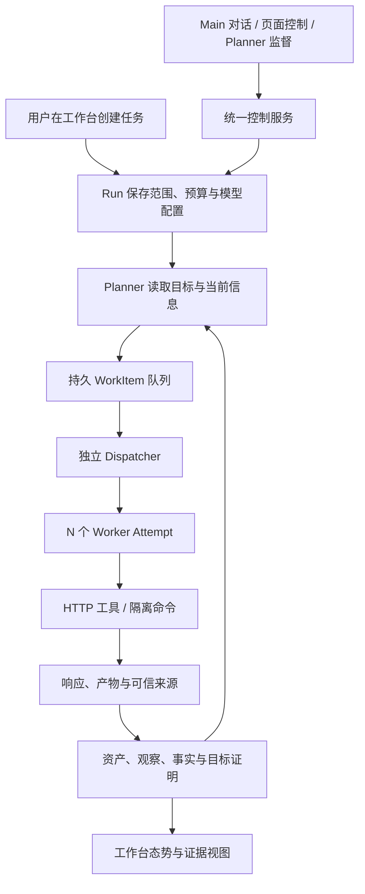

# 项目进展日报：2026-10-22

> 项目：oh-my-offensive-agent。统计日期按北京时间，包含当日本次整理时可见的最新工作区修改。本文汇总当天各 Agent 的开发、集成、审查、验收和本地运行情况，不限于某个 Agent 的工作。依据为 Git 提交、交付文档、测试日志和实际 Run 记录；其他交付记录中的测试结果会注明来源。

## 1. 今天项目推进到了哪里

今天完成了从原有探索原型向多 Agent 工作台的主体升级：Planner 与派工解耦、可配置 N Worker、真实 HTTP/HTTPS 工具与可信证据、隔离命令执行、Main Agent、统一控制入口及工作台已集成。使用本地配置的真实模型，跑通了一个两个 Worker 并发探索、保存事实、满足目标、最终结束并可由 Main 查询结果的完整任务。

但目前只能判断为“核心链路已跑通，可以继续做实际任务验证”。不能据此声称已完整复现 ARTEX，也不能声称复杂靶场探索已经稳定。当天后续使用暴露了启动、页面滚动和中文响应保存问题：前两项已在本地修复并更新服务；最新工作区也已有中文响应保存与 Planner 唤醒合并修复及验证记录，但尚未部署到运行服务。前端还新增了探索画板相关实现，仍需区分代码进展和实际运行验证。

| 交付层次 | 截至本文的状态 |
| --- | --- |
| 多 Agent 主体代码 | 已集成，保留分模块提交 |
| GitHub | 今日集成及可用性修复已合入并推送 main，最后提交为 `bda9f75` |
| 本地运行服务 | 已更新，包含晚于上述提交的启动与滚动修复 |
| 最新本地修改 | 启动、滚动、UTF-8、Planner 唤醒及探索画板等仍未提交、未推送 |
| 真实模型最小完整任务 | 已成功，两个方向完成、两个目标得到证明 |
| 实际靶场连续探索 | 最新任务因 Planner 轮数达到上限而停止；修复后尚未重跑证明覆盖率改善 |

## 2. 今天的工作起点与目标

今天的开发基于前一天的 `1aacadc`。开放意图、资产与探索信息、目标证明、分层预算、同 Run/Epoch 恢复等已有基础，不把这些历史能力全部算作今天新增。

今天主要解决的问题是：双 Worker 使用不稳定，发现模式曾把有效并发强制压为 1，Planner 调用可能阻碍后续派工，真实工具与证据、Main 对话、前端工作台之间还没有形成可用闭环。

整个项目继续以 ARTEX 的核心机制为学习方向。用户在当天明确调整交付优先级：先把核心流程跑通，不把数秒内主动监督、20 轮压力测试或完整发布演练继续作为本轮可用性的前置要求。保留范围、预算和证据校验。

## 3. 各 Agent 交付及集成进展

下表按原分工整理主体工作。后续跨模块接线和修复属于集成阶段，不能把各模块独立测试通过等同于整个系统完成。

| 分工 | 当天完成的主要内容 | 代表提交 |
| --- | --- | --- |
| Agent 0：合同与集成 | 冻结运行时、模型、捕获、执行、控制、工作台接口；建立工作树及独立测试库；分段集成公共注册、路由和启动工厂 | `3b3b733`、`6252083`、`1d4055c` |
| Agent 1：N Worker 运行时 | 去除发现模式强制串行，支持请求并发 1–8；独立 Dispatcher；方向认领、局部失败隔离、撤销和收尾；加入并发重叠反例 | `e6dd947`、`9ec455e`、`937f9db` |
| Agent 2：模型协议与配置 | 区分不完整工具参数、协议及上游错误；会话内有界恢复，真实请求记账；会话历史隔离、角色运行配置解析及共享模型准入 | `6339f68`、`1df11e9`、`6d57c71`、`f0da216`、`207b723` |
| Agent 3：HTTP、认证与证据 | HTTP/HTTPS 捕获、授权范围和重定向检查、凭据引用及脱敏；持久请求响应与可信收据；接入事实来源校验和旧 GET 复测 | `1486a70`、`42cc357`、`fe555b4`、`9c514bd` |
| Agent 4：隔离执行 | Broker、执行容器和 Job 表；命令与工作区工具；状态及退出码、撤销和隔离测试；接入 HTTP 捕获网关 | `88444fc`、`5027086`、`d4dc1c8`、`2946f2e` |
| Agent 5：控制与 Main | 共享 ExecutionController；Planner 监督工具、Main Agent 持久会话、工作台聚合查询及控制 API；接通 REST 与 Planner | `0e9cf2e`、`c14cde2`、`4483bc2`、`1d4055c` |
| Agent 6：工作台 | `workbench.v1` 客户端、任务创建、三栏工作台、方向与证据检查器、Main 会话和控制反馈；旧页面入口接入 | `f10fb6d`、`d77ab03`、`4f47cee`、`e9f2ea4` |
| Agent 7：验收与回归 | 本地靶场与模型替身、A01–A16 场景、失败证据；独立库运行及验收脚本纠正；保留早期失败记录 | `2d4378c`、`357a14f`、`062430c`、`63f6f92`、`4a5b7ab`、`199b940` |

数据库新增迁移为 026、028、029、030，分别覆盖运行时 Attempt 约束、HTTP 捕获、执行 Job、Main 与控制；027 留空，没有为填编号而增加空迁移，也没有重写旧迁移。

## 4. 集成后又补齐了什么

各 Agent 停手后，集成阶段发现“模块存在”和“真实调用链可用”之间仍有缺口，因此继续做了以下修复。

### 4.1 Planner、Worker 与模型请求池

- 保留独立 Dispatcher，Worker 的领取不依赖 Planner 当前模型请求结束。
- 默认内部模型槽位给 Planner 留出空间，避免 Worker 占满默认槽位后监督无法调用模型；显式上游并发上限仍然生效。
- 修复初轮 Planner 把执行期间新增 Worker 变化一起视为已读的问题。
- Worker 完成、事实变化和人工信号可唤醒 Planner；无事件时沿用接近 ARTEX 的十分钟心跳。
- Run、Main 和独立复测复用同一服务进程内的模型限流池；这不是跨进程分布式配额系统。

### 4.2 真实工具、证据和 Main

- 捕获网关给命令代理返回完整且受大小限制的正文，避免把响应预览当完整响应。
- `http_request` 的可信收据接入观察和事实验证，匹配当前方向已有资产时保留关联。
- 通用产物读取可访问同 Run 的 HTTP 捕获正文，继续校验来源并对敏感内容脱敏。
- Main 接入真实模型，使用 Run 的运行配置及本地凭据，恢复历史对话文本；旧工具调用不会随着历史文本重放。
- 减少提示词中重复查询能力、查询自身 trace 和混淆来源 ID 的情况。

### 4.3 创建任务和本地启动

- 创建任务默认使用服务器模型配置，修复虚构模型别名和空能力集导致的不可用。
- 新任务保存显式 HTTP(S) 只读网络授权；可选启用隔离 Python/curl 与工作区文件工具。
- 补齐 Broker 配置、状态卷、工作区路径和本地启动脚本。
- 校正验收请求中的 epoch、幂等键、恢复配置和监督触发方式，没有通过放宽证据或范围校验制造通过。

这部分按六个提交收口：

| 提交 | 内容 |
| --- | --- |
| `0c2937b` | Planner 监督、共享模型准入与 Main 接线 |
| `bb8f250` | 捕获正文到观察、事实的来源链 |
| `e752195` | 工作台创建任务与模型默认配置 |
| `9bc0998` | 隔离执行与模型配置的本地启动 |
| `d7a7781` | 核心验收及真实模型交付证据 |
| `bda9f75` | 验收日志空白整理 |

## 5. 现在实际的工作流程

Planner 决定推进哪些方向；Dispatcher 管领取和并发；Worker 执行具体方向；Main 面向用户解释情况和执行已授权控制。Engine 负责把这些运行环节组织起来，不是另一个负责思考的 Agent。

一个方向是稳定的 WorkItem，一次执行是 Attempt/Session；方向恢复不能简单理解成重建任务。局部额度耗尽也不应自动等同于整个 Run 失败。最终完成需要检查目标和证据，不能仅凭队列清空。

## 6. 今天实际验证到了什么

### 6.1 核心回归

以下是集成修复后的验证结果，证据位于 [core-usable](多Agent核心与工作台-实施计划/证据/core-usable/)。

| 验证 | 结果及边界 |
| --- | --- |
| A01–A08、A12 及相关来源链、P7 回归 | 一轮 race 通过，28.280 秒；不等于 A01–A16 全套通过 |
| Provider、控制、合同、运行时、模型、服务包 | 对应 race 单测通过 |
| HTTP 来源及独立复测回归 | 通过，14.432 秒 |
| 控制、证明、P7 末轮回归 | 通过，10.093 秒 |
| 前端单测 | 10/10 通过 |
| 真实 Go 后端浏览器流程 | 创建、观察 Worker、停止、刷新、方向详情 2/2 通过 |
| 构建与配置 | 前端生产构建、Go vet、Compose 配置检查通过 |

早期进行过 A01–A08 的 20 轮验收及其余场景抽查，整体失败，保留在 [历史验收结果](多Agent核心与工作台-实施计划/验收结果.md)。后续修复后只对本轮核心场景做了有针对性的复验，没有重新证明旧全套压力门禁通过。旧失败不能直接当作当前版本仍有相同问题，也不能因新核心用例通过而删除旧失败。

### 6.2 真实模型完整任务

使用已有本地 `.env` 的模型配置，访问受控本地 fixture，并使用独立测试数据库：

- Run：`17b10f43-bc85-45df-a41b-c3f9186dc5c4`。
- 数据库：`agent_workbench_codex_smoke`。
- 请求 Worker 数为 2，观察到同时活跃 2 个 Worker，最终两个方向完成。
- 保存 2 条 verified fact，2 个目标达到 met，Run 最终为 `completed`。
- Planner 调用模型 10 次、Worker 合计 10 次；显式总额度 32，没有自动加额度。
- Main 查询回合完成；结束后无活动 Session 或未结束模型调用。

另一个诊断 Run 中，真实模型触发了隔离容器里的 Python，Job 完成且退出码为 0；但该 Run 本身因模型额度耗尽停止。因此只证明命令能力实际执行过，不把它记为整个任务成功。

原始摘要：[real-model.json](多Agent核心与工作台-实施计划/证据/core-usable/real-model.json)。

## 7. 合入 main 后的本地问题及修复

### 7.1 创建任务时 Internal Server Error

原因是 Broker 镜像已有 `ENTRYPOINT /oma-broker`，Compose 的 command 又重复带了二进制名称，导致监听参数未被正确解析。Broker 只监听容器内回环地址，后端无法连接并启动失败，前端 API 代理随之报错。

本地已修复：Compose command 只传参数，Broker 正确监听容器接口；增加 Broker 和后端健康检查、依赖健康再启动以及脚本等待就绪；Broker 额外拒绝意外位置参数，避免同类配置错误悄悄发生。

### 7.2 页面没有滚动条

工作台固定高度和嵌套容器的 overflow 设置不完整，较矮或较窄窗口中创建表单底部无法访问。

本地已修复表单、顶部和执行视图的滚动布局。浏览器在 1280×600、900×500、390×600 三种窗口下验证提交位置可滚动到达，3/3 通过。另一次真实后端的创建、观察 Worker、停止流程 1/1 通过；此项使用 Mock 模型，不代表又做了一次真实模型扫描。

### 7.3 本地运行状态

约 18:14 更新了 backend、frontend、execution-broker 及 fixture；保留原数据库卷。本文整理时，数据库、后端和 Broker 健康，前端和 fixture 运行中。

这批启动与滚动修复仍在工作区，尚未提交或推送；当前运行服务因此比 GitHub main 多了这批修改。相关日志暂存在 `/tmp/oma-scroll-live-test.log` 和 `/tmp/oma-startup-create-live-test.log`，属于临时文件，不能作为长期证据存档依赖。

## 8. 最新靶场任务暴露的问题

用户反馈“发现页面比之前少”。对任务记录、实际错误和代码的只读排查结果如下；本次排查没有重跑靶场、没有新增模型调用。

### 8.1 不是发现参数被调小

最新 Run `d48c05d9-e965-4d7e-8719-854f9689284f` 在北京时间约 18:18 创建，目标为用户提供的靶场。

| 参数或结果 | 最新任务 | 之前同目标任务 |
| --- | --- | --- |
| 登记页面数，含首页 | 10 | 最近一次 10，更早一次 12 |
| 发现范围 | 同源 HTML、GET | 相同 |
| 发现上限 / 深度 | 20 页 / 2 | 相同 |
| 模型调用上限 | 80 | 30 |
| 工具调用上限 | 200 | 30 |
| 总时限 | 600 秒 | 120 秒 |
| Worker 并发 | 3 | 1 |

最新任务预算更大，但没有转化成更多页面。登记资产也不等于成功访问或完成分析，不能只看资产总数判断探索质量。

### 8.2 已确认：中文预览截断导致持久化失败

`backend/internal/netcap/redact.go` 的 `redactBodyPreview` 直接截取前 512 字节，可能把 UTF-8 汉字截成半个。无效字符串进入 PostgreSQL 文本字段后报 `invalid byte sequence for encoding "UTF8"`。

使用该 Run 已保存的响应正文验证了 `/news`、`/products`、`/about`、`/contact`：它们虽然已经返回 HTTP 200，但前 512 字节都恰好截在一个中文字符中间。该错误导致请求结果的持久化失败，阻碍后续读取和链接提取。

因此不是靶场没有返回页面，也不是先提高预算就能解决。后续工作区已出现针对该边界的修复及中文页面保存、链接提取回归，状态见下一节。

### 8.3 已确认：Planner 轮数达到上限；消耗策略待检查

最新任务约 3 分 6 秒就停止，状态为 `stopped`、原因为 `needs_input`，最终说明是 `Planner round limit reached`，没有跑满 600 秒。

记录中有 69 次模型调用、90 次工具调用，10 个方向里 1 个完成、9 个耗尽。Planner 多次事件唤醒，并尝试读取失败 trace、HEAD 取证及从产物找回正文。编码错误消耗了大量探索机会。

后续修复记录明确：8 限制的是后续评估轮，数据库中是初轮加 8 个后续轮，其中 6 个为事件唤醒；本次没有提高该硬上限。已定位并修复一个通知合并旁路，但不能把全部历史轮次都判成重复唤醒，也不能保证修复后任务一定用满时限。

### 8.4 整理期间补入的最新交付

以下修改由最新工作区和 [UTF-8 响应预览与 Planner 唤醒修复记录](UTF8预览与Planner唤醒修复-2026-10-22.md) 确认。本日报检查了代码差异和交付记录，没有重复执行其中的测试。

| 内容 | 已有进展 | 验证与运行边界 |
| --- | --- | --- |
| UTF-8 预览 | 截取时退回完整字符边界，保留 512 字节上限和先脱敏再截断顺序 | 交付记录报告 netcap race 通过，覆盖中文预览入库和完整正文读取；尚未部署 |
| Planner 通知合并 | dirty、持久变化及通知路径进入下一轮前统一执行有界合并，合并期间可取消 | 交付记录报告调度单测和运行时回归通过；不提高轮数预算，不保证所有任务覆盖率提升 |
| 中文发现闭环 | 新增实际 SessionRunner 驱动的 `get_endpoint → extract_endpoint_links` 回归 | 交付记录报告通过，登记预览边界之外的链接；使用本地 HTTP 和隔离库，没有重跑靶场 |
| 前端探索画板 | 新增 `ExplorationCanvas`、执行/图谱切换、节点及关系展示、图形依赖和界面调整 | 可见代码、fixture 截图及新增浏览器用例；本日报未核实本轮整套前端测试结果，也未确认已更新运行镜像 |
| 后端探索图查询 | `GraphOverview` 新增有效探索边的摘要输出，供前端使用 | 工作区实现已存在；真实图谱端到端验证状态待补充 |

修复记录报告的具体结果包括：netcap race 7.876 秒、orchestration race 1.189 秒、相关运行时集成回归 31.600 秒、中文发现闭环 2.360 秒，以及相关 Go vet 通过。测试使用隔离 PostgreSQL 和本地服务，没有修改既有 Run、请求靶场或调用真实模型。

这些是“已实现且有交付验证记录”的后续进展，不能反推 18:18 的原任务已经成功，也不能与已部署的启动修复混为一个运行版本。

## 9. 与 ARTEX 的接近程度和当前能力边界

| 核心机制 | 当前进展 | 仍需注意的边界 |
| --- | --- | --- |
| 开放意图与 N Worker | 已接通，真实模型验证两个 Worker 同时活跃 | 更多 Worker 不自动带来更好任务拆分或覆盖率 |
| Planner 事件及心跳监督 | 已接通；新增通知合并旁路修复及回归记录 | 新修复尚未部署，实际任务效果待验证；不要求秒级干预 |
| Worker 稳定方向与恢复 | 沿用现有 WorkItem/Attempt/会话历史机制 | 恢复对话不等于恢复外部工具进程 |
| 共享知识、来源与目标证明 | 已接通，真实任务生成事实并满足目标 | 来源可信不等于自然语言漏洞结论自动成立 |
| Main 对话与统一控制 | 已接通真实模型和共享控制服务 | 不代表复杂多轮人工指挥都已验证 |
| 真实 HTTP/HTTPS 与认证 | 有实现及模块测试，基础 HTTP 任务已跑通；中文预览修复已落到工作区 | 新修复尚未部署；复杂认证业务闭环未充分验证 |
| 隔离命令与产物 | Python 已实际执行，Job 和来源链有实现 | 未单独完成命令容器经真实网关访问网络的整链 smoke |
| 工作台 | 可创建、观察、查询和停止；工作区新增探索画板和图关系数据 | 新画板的真实运行验证待补充；复杂业务协作全流程尚未证明稳定 |

本工程保留 PostgreSQL 状态权威、execution epoch、总预算硬上限和授权账本；这些属于工程适配，不能说成 ARTEX 原样采用的设计。角色模型解析已具备基础，但复杂多服务、不同角色模型路由及相关管理 UI 暂缓。

当前适合做小范围、已授权 Web 目标的入口探索、页面响应观察、多方向材料收集和可追溯交付。复杂认证联动、业务逻辑漏洞、自主利用及长任务稳定性，还没有足够实际证据支撑完成声明。

## 10. Git 与文档状态

- 今天相对 `1aacadc` 新增并合入 main 共 40 个提交，保留主体模块与后续修复的分段历史。
- 已推送版本为 `bda9f75156bad6224353b72619b8ecafc1f48436`；本文检查时本地 main 与 origin/main 跟踪引用一致。
- 启动、滚动、UTF-8、Planner 唤醒合并、探索图查询及前端画板相关修改尚未提交。运行服务已包含启动和滚动修复；其后的新修改不能默认为已部署。
- `.env`、本地 `AGENTS.md` 不上传；用户另有技术分享稿，本次未修改、未纳入提交。
- 部分历史协调和验收文档仍写着“未合 main”“未启动服务”等当时状态。应结合文档对应的版本和时间阅读；本文记录截至当前的后续进展，不改写历史失败事实。

相关入口：

- [多 Agent 核心与工作台实施计划](多Agent核心与工作台-实施计划/README.md)：模块、合同和分工。
- [协调状态](多Agent核心与工作台-实施计划/协调状态.md)：各 Agent 工作树、集成及历史状态。
- [可用性收口与运行说明](多Agent核心与工作台-实施计划/可用性收口与运行说明.md)：本轮核心修复、真实模型与启动说明。
- [交付检查表](多Agent核心与工作台-实施计划/交付检查表.md)：核心交付与证据。
- [历史验收结果](多Agent核心与工作台-实施计划/验收结果.md)：早期失败及未完成的完整验收。

## 11. 下一步建议顺序

1. 集成审查最新 UTF-8 和 Planner 唤醒修复及对应验证记录，确认没有覆盖其他工作区修改。
2. 补齐新探索画板与后端图关系查询的联调证据，确认原创建、停止、窄屏滚动等流程仍可用。
3. 更新运行服务后，用同一个已授权靶场做一次有界回归，分别记录登记页面、成功读取、完成方向和停止原因；不要只比较资产总数。
4. 把已验证的启动、滚动及后续修复按模块提交，再更新远端和运行说明。

继续以可用的多 Agent 核心为重心。完整压力测试、认证管理 UI、复杂角色路由和周边功能可以按后续实际需求推进，不扩成本轮的额外前置门槛。
