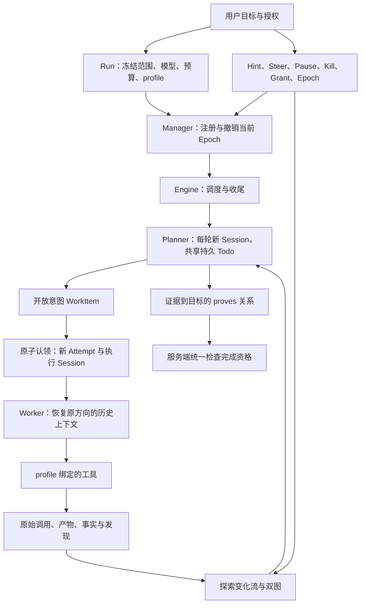

# ARTEX 对齐：当前架构与完整工作流

更新：2026-10-21。本文件描述当前代码；早期阶段文档保留为历史。验证命令见《本轮补齐验收-2026-10-21》。

## 1. Engine、Orchestrator 和模型的关系

`orchestrator` 是执行模式名称，`orchestration.Engine` 是实现这种模式的运行时。Engine 自己不承担模型推理：它组织 Planner 和 Worker 的 SessionRunner，后者通过 Provider 调用模型。Manager 管生命周期、取消与执行代次，业务 Service 管持久状态和约束。

一次模型响应不等于一次任务完成。模型只能提出方向、调用已授权工具、提供证据或建议完成；状态机、范围、预算、来源、版本及终态资格由服务端判断。

## 2. 从任务到自主探索

1. 用户选择目标种子、填写交付目标及能力配置，开启自主探索。创建 Run 时冻结输入，原始目标成为 `open` Goal。旧规则扫描任务仍可读取。
2. 初始种子从授权范围建立 RunAsset 快照。`get_endpoint` 必须同时满足 Run 与 WorkItem 的资产范围，URL 从快照解析；不会直接执行模型编造的任意地址。
3. Planner 读取双图、待办、方向状态、预算及真实 trace，提交 `work_type=intent` 的开放方向。方向可以引用多个来源事实；服务端校验事实归属、版本和 profile 身份。
4. Engine 原子认领 pending 方向，创建 Attempt 和 Session。Worker 使用对应 profile 的工具集，依目标选择步骤；已有固定分析工具仍可作为专用适配器使用。
5. Worker 记录结果、Fact 或 Finding。持久探索变化和内存合并通知唤醒 Planner；Worker 未结束时也能产生下一方向。重复同一事实不会制造新进展。
6. Planner 可继续、重试、换方向或等待。每轮创建新 Session，并保留 `planner_todos`；不会把 Worker 的完整对话恢复方式套给 Planner。

资产图表示对象及其关系；探索图表示为什么调查它、依据什么证据、接下来做什么以及哪些目标已证明。两者通过 anchors 关联。新增 app/host/IP/service 当前只从已授权 HTTP endpoint 推导规范身份，记录明确的来源关系；不执行端口扫描，不把身份关系当作新网络授权。

## 3. Worker 预算耗尽与恢复

局部模型次数、工具次数和时长耗尽后，Worker 进入受限 settlement，保存已有结果、事实及发现。它不能借收尾继续探测，随后方向进入 `exhausted`。Planner 查看过程，决定是否调用 `continue_work_item`。继续只进入 pending，真正调度时才创建新 Attempt。

WorkItem 和 Conversation 身份稳定，Attempt 与执行 Session 每次变化。恢复使用原始消息、Provider 原生状态和有效检查点。已保存的成功结果可以复用；没有自动保证模型绝不重复读取，也不把恢复对话等同于恢复工具进程。

中断的多工具批次需要协议闭合：已知持久结果恢复为 success/failed/rejected；已经准入但结果未知的调用明确为 `outcome_unknown`；从未准入的是 `unexecuted`。未知结果不能伪装成功或自动重放外部动作。Chat Completions 和 Responses 的原生历史分别保留。

Worker 故障属于该方向的失败，原 Attempt 保留原因，Planner 可决定重试。全局预算、用户停止、Run deadline 与内部持久化故障则走统一收尾。用量不因创建新 Attempt 或 Epoch 归零。

## 4. 完整产物与上下文压缩

工具完整输出先持久保存，模型获得有界预览及产物指针。产物保留 Run、WorkItem、Session、调用、Epoch、SHA-256 和完整 UTF-8 内容。数据库内容为权威，受控工作目录是可复用投影。单产物当前上限 8 MiB，支持分段读取；跨 Run、目录穿越和符号链接逃逸被拒绝。

`list_artifacts`、`read_artifact`、`get_worker_output`、`inspect_artifact` 允许 Worker 检查大输出。过程检索让另一个 Worker 利用尚未转成 Fact 的细节，不需要复制整段对话。

接近配置的字节窗口时，以完整历史协议块生成确定性的提取式检查点，保留系统约束和最近交互。检查点记录覆盖消息数、原始哈希、策略、版本和摘要；原文不删除。恢复先验证覆盖区间再接上新尾部；不能安全压缩或源哈希不匹配时明确失败。摘要不作为事实或目标证明。这与 ARTEX 使用的 SDK 语义压缩存在有意差异。

## 5. 目标证明、发现与复测

Fact 的 `verified` 表示来源链通过程序校验，不表示所有文字推断自动正确。`empirical` Finding 要引用同 Run、同目标、当前 Epoch 的成功 `get_endpoint` 真实响应；资产自由的知识查询不构成实测。旧报告兼容缺少显式验证条件的情况，因此来源核验、人工审核和漏洞可利用性必须分别理解。

`prove_goal` 接受已核验 Fact/Finding 和说明，保存来源/目标内容版本。服务端检查证据资格，但不具备任意自然语言命题的自动证明能力。目标修改、事实撤回、误报审核或 fixed 复测会使相关证明失效；历史边与修订记录保留。所有目标仍有效地 met 且没有未完成方向时，服务端才接受完整完成；队列清空、访问过页面或模型说完成都不够。

独立复测创建 verifier Session，使用独立额度和当次目标响应，不重启原扫描。原发现可保存两组互斥 HTTP 条件：`vulnerable` 和 `fixed`。本轮成功响应只能唯一匹配其中一组，才能得出 still_reproducible 或 fixed；两者都不匹配、同时匹配、证据不属于本会话、缺条件、调用失败等情况均为 inconclusive。模型描述只是说明文字，不能裁决修复。手动提交也走同一校验。

复测只更新处置投影，并保留原证据、原扫描终态和人工审核历史。fixed 会打开受影响的 Goal，提示后续需要重新证明，而不会改写过去的执行记录。

## 6. 人工控制与新 Epoch

- **Hint**：写入探索图，供 Planner 阅读，不修改原始目标或扩大资产范围。Run 页面可直接提交文字和关联资产。
- **Steer**：持久控制消息，在下一安全模型边界与原始 transcript 原子写入并确认，避免重启丢失或重复投递。不会覆盖最初的方向输入。
- **Pause / Resume**：本工程采用在线屏障，暂停禁止新派工、模型和工具准入，保留当前 Attempt；已经发出的请求不承诺撤回。恢复同一 Epoch。暂停不赠送额外时长；到期需要显式追加授权和新 Epoch。
- **Kill**：只停止目标方向，保留其 Attempt 记录。之后恢复父 Run 也不会复活这个被明确 Kill 的方向。
- **Grant Budget**：操作员追加总模型/工具次数或运行秒数，记录幂等账本。活跃 Engine 动态刷新；模型无权自行增加全局授权。
- **Start New Epoch**：用户显式批准同一 Run 继续执行。先停妥旧 Engine，持久关闭旧代次，再注册新 Engine。Run 收尾造成的 cancelled 方向转为可申请继续的 exhausted，Planner 仍需主动选择续跑；不会直接批量派工。已完成方向和单独 Kill 的方向保持终态。新旧 Attempt、Session、产物、用量和总结都保留。

Manager 注册/释放、准入、知识写入、检查点和终态协调受 Epoch 约束。重复 Epoch 请求带 expected_epoch 与幂等键；启动失败会形成持久失败状态。服务重启撤销旧执行资格，等待明确恢复。

## 7. 当前页面操作路径

任务列表 → New Task → 选择授权目标 → 填写交付目标 → 可选 profile → 创建 → 选择 Provider → Start Run。

Run 中可看目标与探索图、工作项的 Attempts/消息、事件、预算和代次。“能力、完整产物与探索关系”提供能力快照、人工 Hint、产物分段读取、来源关系导航、目标修订/证据证明、事实撤回及检查点摘要。审核面板保留人工审核与独立复测。终态后的知识/复测变化可点击“刷新资料”读取最新目标投影。

完整浏览器验收使用本地 Chat Completions 替身与真实 HTTP fixture，已覆盖暂停纠偏、原方向续跑、目标证明、审核及补丁复测。它验证工程链路，不代表商业模型面对未知真实漏洞的发现率已经评估。

## 8. 参考源码与实现差异

| 机制 | ARTEX 源码 | 本工程适配 |
| --- | --- | --- |
| 稳定 Worker 对话 | `agent/worker.go:497–506` | 稳定 WorkItem，多 Attempt，持久消息和原生 Provider 状态 |
| Planner 跨轮待办 | `agent/planner.go:108`、`:430–433` | 每轮新 Session，Todo 使用 PostgreSQL 持久化 |
| settlement、长输出与 compaction | `agent/worker.go:425–467` | 双层额度、受限收尾、数据库产物、协议块检查点 |
| 能力集与扩展 | `agent/toolcatalog.go`、`agent/worker.go:374` | 服务器注册工厂 + 版本化 profile，本地适配器验收；未连接外部 MCP/skills 服务 |
| 事件调度与继续 | `server/engine.go` | 持久变化流/游标 + 内存合并通知 |
| 独立验证 | `server/finding_retests.go` | 独立 verifier 与程序化 HTTP 条件裁决，保留审核 |

Epoch、全局硬额度和追加授权账本是本工程的适配，不能说成 ARTEX 的同名原机制。现阶段也没有任意 Shell、通用命令工具、完整代理流量录制或对任意工具 HTTPS 的捕获保证。
